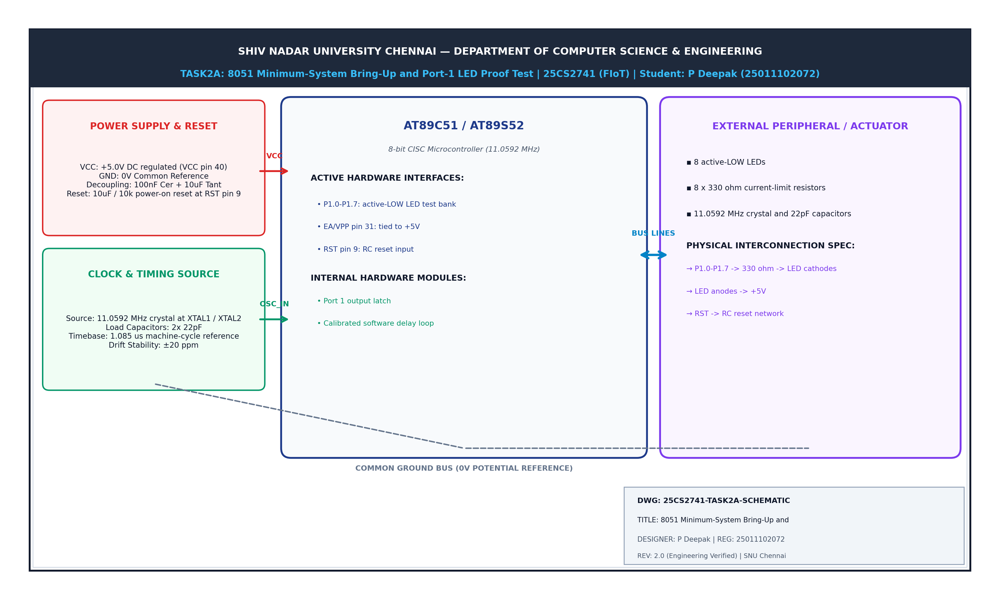

# EXPERIMENT DETAILS

**EXP:** CAT 2 - TASK2A

**DATE:** Not specified in course evaluation sheet

**NAME OF EXP:** 8051 Minimum-System Bring-Up and Port-1 LED Proof Test

**HARDWARE SETUP / PLATFORM:** AT89C51 / AT89S52 8051 microcontroller at 11.0592 MHz, Keil C51, 5 V laboratory trainer

---

## TASK2A : 8051 Minimum-System Bring-Up and Port-1 LED Proof Test

### 1. Circuit Diagram

Port 1 (P1.0-P1.7) drives eight active-low LEDs through 330 ohm resistors. The board uses an 11.0592 MHz crystal, 22 pF load capacitors, an RC reset network and a regulated 5 V supply.

### 2. Core Logic / Pseudocode / Code Base

**Working Principle:**

An AT89C51 minimum system is validated by alternately driving all Port 1 latches low and high. With active-low LEDs, the two states visibly confirm reset release, oscillator operation and execution from internal program memory.

**Pseudocode:**

After reset, configure Port 1 high. Repeatedly write 00H, wait 250 ms, write FFH, wait 250 ms, and repeat.

**Code Structure / Key Registers:**

The `main.c` firmware uses direct 8051 special-function-register access. Port latches are addressed through `P1` and `P2`; the delay routine is intentionally kept local so timing assumptions remain visible during lab review.

### 3. Inference

The alternating full-bank pattern verifies a functioning 8051 clock, reset circuit, flash execution path and Port 1 output drivers.
