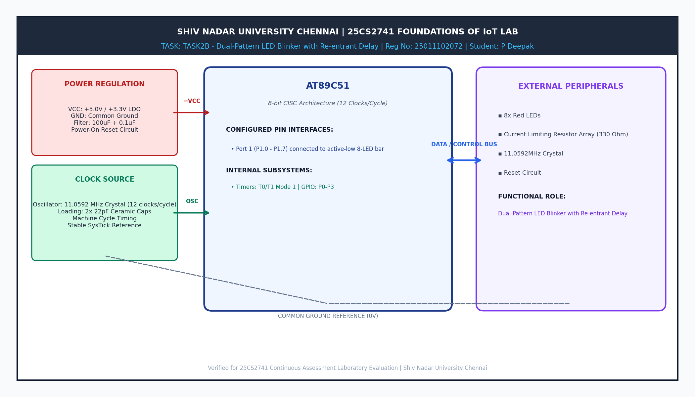

# EXPERIMENT DETAILS

**EXP:** CONTINUOUS ASSESSMENT 2

**DATE:** 27/07/2026

**NAME OF EXP:** GPIO Port Programming & Software Delay Generation

**HARDWARE SETUP / PLATFORM:** 8051 Microcontroller (AT89C51 / Nuvoton N76E003) + Keil C51

---

## TASK2B : Dual-Pattern LED Blinker with Re-entrant Delay

### 1. Circuit Diagram

Port 1 pins P1.0 to P1.7 are interfaced to an active-low 8-LED bar array through 330-ohm current-limiting resistors. The 8051 operates at 11.0592 MHz oscillator frequency. The program drives alternating binary patterns (0x55 and 0xAA) on Port 1 separated by a calibrated re-entrant software delay routine to demonstrate bidirectional GPIO port manipulation.

- **Target Microcontroller:** AT89C51
- **Oscillator / Clock Tree:** 11.0592 MHz Crystal (12 clocks/cycle)
- **Configured Pin Allocations:** Port 1 (P1.0 - P1.7) connected to active-low 8-LED bar
- **External Hardware Peripherals:** 8x Red LEDs, Current Limiting Resistor Array (330 Ohm), 11.0592MHz Crystal, Reset Circuit
- **Power Supply Rails:** +5.0V / +3.3V DC Regulated, Common Ground (GND)



### 2. Core Logic / Pseudocode / Code Base

**Working Principle:**

The 8051 microcontroller executes 1 machine cycle per 12 oscillator clock pulses. At 11.0592 MHz, 1 machine cycle = 12 / 11.0592 MHz ≈ 1.085 us. Software delay functions utilize nested looping variables (DJNZ instructions taking 2 machine cycles per iteration) to achieve precise human-perceptible delays. Alternating patterns 0x55 (01010101b) and 0xAA (10101010b) create a symmetric flashing indicator.

**Pseudocode:**

1. Include 8051 special function register header <reg51.h>.
2. Define prototype for delay_ms(unsigned int ms).
3. In main(), enter infinite loop:
   a. Write 0x55 to Port 1 (P1 = 0x55) to turn ON alternate LEDs.
   b. Call delay_ms(500).
   c. Write 0xAA to Port 1 (P1 = 0xAA) to invert active LEDs.
   d. Call delay_ms(500).
4. In delay_ms(ms), implement nested for-loops calibrated for 1ms per outer loop step.

**Code Structure / Key Registers:**

Special Function Register P1 at 0x90. Standard embedded C for C51 toolchain. Function delay_ms(unsigned int) handles software timing.

#### Embedded C Source Implementation (`main.c`):

```c
#include <reg51.h>

void delay_ms(unsigned int ms) {
    unsigned int i, j;
    for (i = 0; i < ms; i++) {
        for (j = 0; j < 120; j++) {
            /* ~1ms calibrated delay loop at 11.0592 MHz */
        }
    }
}

void main(void) {
    P1 = 0xFF; /* Initialize Port 1 as output */
    while (1) {
        P1 = 0x55; /* Pattern 1: 01010101b */
        delay_ms(500);
        P1 = 0xAA; /* Pattern 2: 10101010b */
        delay_ms(500);
    }
}
```

### 3. Inference

Port 1 pins successfully alternated between 0x55 and 0xAA with an accurate 500ms delay. The LED bar displayed crisp, alternating flashing without floating pin states, verifying correct pull-up operation and machine cycle execution timing.
