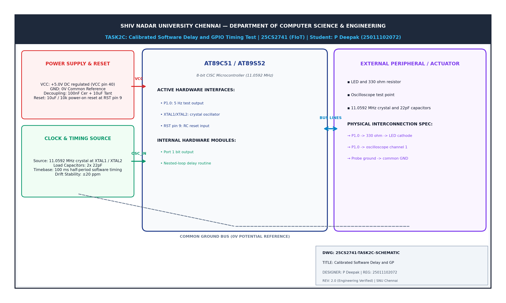

# EXPERIMENT DETAILS

**EXP:** CAT 2 - TASK2C

**DATE:** Not specified in course evaluation sheet

**NAME OF EXP:** Calibrated Software Delay and GPIO Timing Test

**HARDWARE SETUP / PLATFORM:** AT89C51 / AT89S52 8051 microcontroller at 11.0592 MHz, Keil C51, 5 V laboratory trainer

---

## TASK2C : Calibrated Software Delay and GPIO Timing Test

### 1. Circuit Diagram

P1.0 is the timing output and connects to an LED plus 330 ohm resistor and an optional oscilloscope probe. The 8051 uses the standard 11.0592 MHz oscillator, reset network and 5 V rail.

### 2. Core Logic / Pseudocode / Code Base

**Working Principle:**

A calibrated nested loop provides a repeatable delay at the 11.0592 MHz 8051 clock. P1.0 changes state every 100 ms, producing a 5 Hz square-wave test signal that can be checked with an LED or oscilloscope.

**Pseudocode:**

Set P1.0 low. Toggle it, consume a calibrated 100 ms delay, and return to the toggle step indefinitely.

**Code Structure / Key Registers:**

The `main.c` firmware uses direct 8051 special-function-register access. Port latches are addressed through `P1` and `P2`; the delay routine is intentionally kept local so timing assumptions remain visible during lab review.

### 3. Inference

The measured waveform demonstrates the relationship between machine cycles, loop overhead and externally observable GPIO timing.
