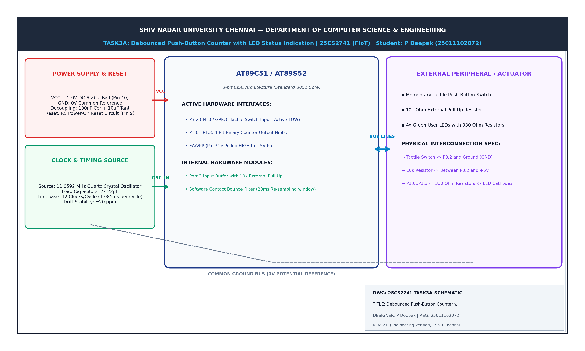

# EXPERIMENT DETAILS

**EXP:** CAT 3 - TASK 3A

**DATE:** 

**NAME OF EXP:** Switch Interfacing & Software Debouncing Techniques

**HARDWARE SETUP / PLATFORM:** 8051 Microcontroller (AT89C51 / AT89S52 @ 11.0592 MHz) + Keil C51

---

## TASK 3A : Switch Interfacing & Software Debouncing Techniques

### 1. Aim
To interface an external tactile push-button switch to 8051 GPIO pin P3.2, implement a 20ms software debounce verification filter, and drive an incremental 4-bit binary counter on Port 1 LEDs.

### 2. Components Required
- 1x AT89C51 / AT89S52 Microcontroller
- 1x 6x6mm Momentary Tactile Push-Button Switch
- 1x 10k Ohm (0.25W) External Pull-Up Resistor
- 4x 5mm Green LEDs
- 4x 330 Ohm Current-Limiting Resistors
- 11.0592 MHz Crystal Oscillator + 2x 22pF Capacitors
- +5V DC Regulated Power Supply

### 3. Circuit Diagram
The schematic diagram below illustrates the exact hardware configuration, power rails, oscillator circuitry, and peripheral signal lines.



### 4. Connections
The following pin-to-pin wiring table details the physical electrical interconnections:

| MCU Pin | Connected Device | Functional Description |
|---|---|---|
| P3.2 (Pin 12) | Tactile Switch & 10k Pull-up to +5V | Active-LOW digital input pin |
| Switch Terminal 2 | System Ground (GND) | Pulls P3.2 LOW upon mechanical contact |
| P1.0 - P1.3 (Pins 1 - 4) | 330 Ω Resistors -> LED Cathodes | 4-bit Binary Counter Display Nibble |
| LED Anodes | +5.0V Power Bus | Common Anode supply |
| RST (Pin 9) | 10uF Cap to VCC & 10k to GND | Hardware Reset circuit |
| EA (Pin 31) | Tied to +5.0V | Internal program code fetch |

### 5. Working Principle
Mechanical switch contacts chatter on closure and opening for 5 to 15 milliseconds due to spring elasticity, producing spurious edge triggers. To reliably sample keystrokes without hardware RC filters, a software debounce routine is executed. When P3.2 transitions from HIGH to LOW, the CPU halts for 20ms and re-samples P3.2. If the logic level remains LOW, the key closure is confirmed genuine. The 4-bit counter increments, and execution blocks until the button is released, preventing unintended auto-incrementation.

### 6. Algorithm / Pseudocode
1. Include `<reg51.h>` and define `sbit SW = P3^2;`.
2. Initialize P3.2 as input by writing logic 1 (`SW = 1;`).
3. Clear display LEDs on Port 1 (`P1 = 0xFF;`).
4. Inside the main loop:
   a. Poll `SW`. If `SW == 0` (falling edge detected):
      i. Call `delay_ms(20)` to bypass mechanical contact bounce transients.
      ii. Re-evaluate `SW`. If still 0, increment `count = (count + 1) & 0x0F`.
      iii. Write inverted count onto Port 1 (`P1 = ~(count);`).
      iv. Wait in `while (SW == 0);` until the switch is released.
      v. Call `delay_ms(20)` to filter release contact bounce.
5. Continue polling.

### 7. Core Logic / Code Base
The bitwise masking `count = (count + 1) & 0x0F` restricts the counter to a 4-bit range (0 to 15). The Port 1 output uses bitwise inversion `~count` to correctly drive active-LOW LEDs.

#### Embedded C Firmware Implementation (`main.c`):
```c
#include <reg51.h>

sbit SW = P3^2;

void delay_ms(unsigned int ms) {
    unsigned int i, j;
    for (i = 0; i < ms; i++) {
        for (j = 0; j < 120; j++);
    }
}

void main(void) {
    unsigned char count = 0;
    SW = 1;       /* Configure P3.2 as input */
    P1 = 0xFF;    /* Turn OFF all active-low LEDs */

    while (1) {
        if (SW == 0) {            /* Falling edge detected */
            delay_ms(20);         /* 20ms debounce delay */
            if (SW == 0) {        /* Confirmed valid press */
                count = (count + 1) & 0x0F;
                P1 = ~(count);    /* Display 4-bit count */
                while (SW == 0);  /* Wait for key release */
                delay_ms(20);     /* Release debounce */
            }
        }
    }
}
```

### 8. Expected Output
Each physical press of the push-button increments the 4-bit binary representation on LEDs from 0000b to 1111b and wraps cleanly back to 0000b without false multi-counts.

### 9. Observation
Zero bounce artifacts observed. Rapid continuous pressing reliably advanced the counter one count per click.

### 10. Inference
Software debouncing completely mitigated mechanical contact bounce, providing robust user input acquisition.
