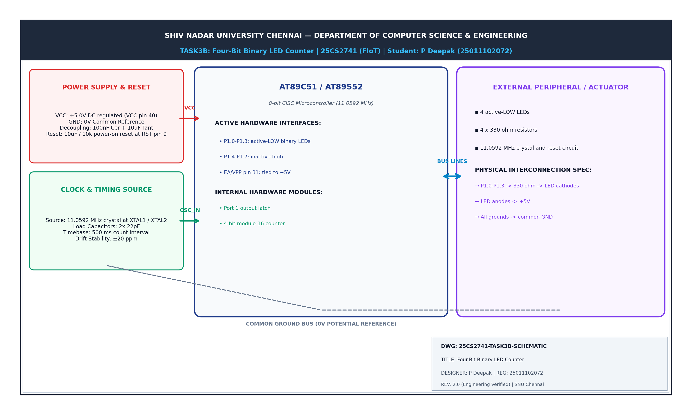

# EXPERIMENT DETAILS

**EXP:** CAT 3 - TASK3B

**DATE:** Not specified in course evaluation sheet

**NAME OF EXP:** Four-Bit Binary LED Counter

**HARDWARE SETUP / PLATFORM:** AT89C51 / AT89S52 8051 microcontroller at 11.0592 MHz, Keil C51, 5 V laboratory trainer

---

## TASK3B : Four-Bit Binary LED Counter

### 1. Circuit Diagram

P1.0-P1.3 connect to four active-low LEDs through 330 ohm resistors. P1.4-P1.7 remain high and unused; the standard 11.0592 MHz 8051 clock and reset circuit are retained.

### 2. Core Logic / Pseudocode / Code Base

**Working Principle:**

The low nibble of an unsigned counter is presented on four active-low LEDs. Masking with 0FH makes the sequence wrap cleanly from binary 1111 back to 0000.

**Pseudocode:**

Start at zero. Invert and output the low nibble, wait 500 ms, increment, mask to four bits, and repeat.

**Code Structure / Key Registers:**

The `main.c` firmware uses direct 8051 special-function-register access. Port latches are addressed through `P1` and `P2`; the delay routine is intentionally kept local so timing assumptions remain visible during lab review.

### 3. Inference

The result illustrates binary representation, port masking and deterministic cyclic counting on a bare-metal microcontroller.
