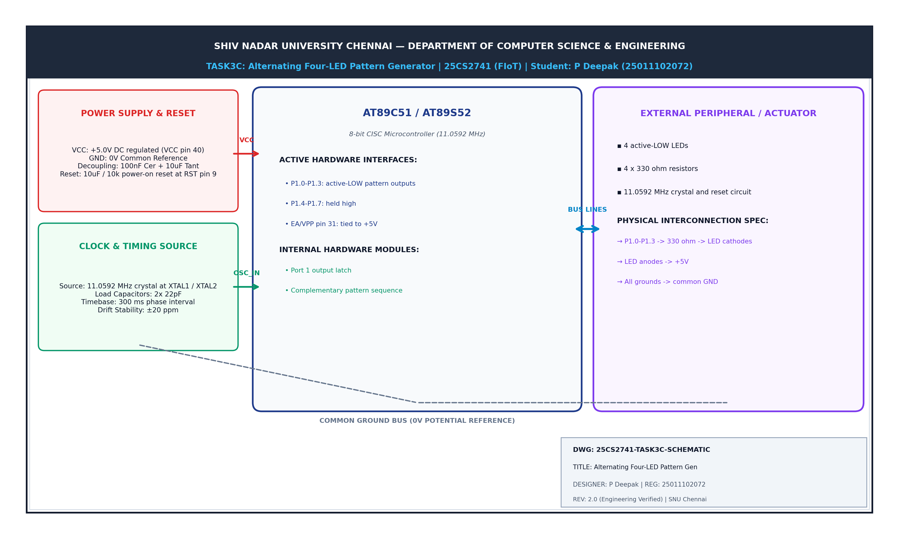

# EXPERIMENT DETAILS

**EXP:** CAT 3 - TASK3C

**DATE:** Not specified in course evaluation sheet

**NAME OF EXP:** Alternating Four-LED Pattern Generator

**HARDWARE SETUP / PLATFORM:** AT89C51 / AT89S52 8051 microcontroller at 11.0592 MHz, Keil C51, 5 V laboratory trainer

---

## TASK3C : Alternating Four-LED Pattern Generator

### 1. Circuit Diagram

P1.0-P1.3 are active-low outputs to four LEDs and 330 ohm resistors. The system clock is the 11.0592 MHz crystal with the normal 8051 reset and 5 V supply circuitry.

### 2. Core Logic / Pseudocode / Code Base

**Working Principle:**

Two complementary bit masks are written to the lower Port 1 nibble. The masks select alternate LEDs, producing a symmetric two-phase pattern without needing interrupt or timer hardware.

**Pseudocode:**

Write the first alternating mask, delay 300 ms, write its complement, delay 300 ms, then loop.

**Code Structure / Key Registers:**

The `main.c` firmware uses direct 8051 special-function-register access. Port latches are addressed through `P1` and `P2`; the delay routine is intentionally kept local so timing assumptions remain visible during lab review.

### 3. Inference

Complementary output patterns demonstrate bitwise masking and simple temporal sequencing for visual indicators.
