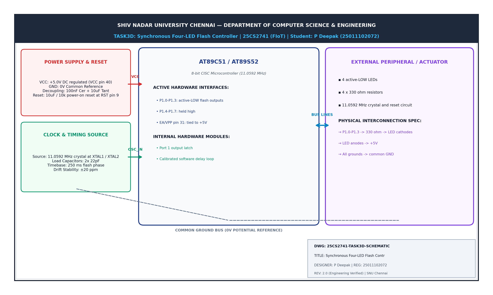

# EXPERIMENT DETAILS

**EXP:** CAT 3 - TASK3D

**DATE:** Not specified in course evaluation sheet

**NAME OF EXP:** Synchronous Four-LED Flash Controller

**HARDWARE SETUP / PLATFORM:** AT89C51 / AT89S52 8051 microcontroller at 11.0592 MHz, Keil C51, 5 V laboratory trainer

---

## TASK3D : Synchronous Four-LED Flash Controller

### 1. Circuit Diagram

P1.0-P1.3 drive four active-low LEDs through 330 ohm resistors. P1.4-P1.7 are held high. The oscillator, reset circuit and 5 V rail follow the 8051 minimum-system connection.

### 2. Core Logic / Pseudocode / Code Base

**Working Principle:**

All four LED outputs are asserted together, held for a fixed interval, and then released together. This creates a uniform visual flash that is useful as a basic status or alarm indication.

**Pseudocode:**

Drive the four LED bits low, delay 250 ms, drive them high, delay 250 ms, and continue forever.

**Code Structure / Key Registers:**

The `main.c` firmware uses direct 8051 special-function-register access. Port latches are addressed through `P1` and `P2`; the delay routine is intentionally kept local so timing assumptions remain visible during lab review.

### 3. Inference

A shared output mask is sufficient for synchronized indication and reinforces the active-low convention used by the lab LED board.
