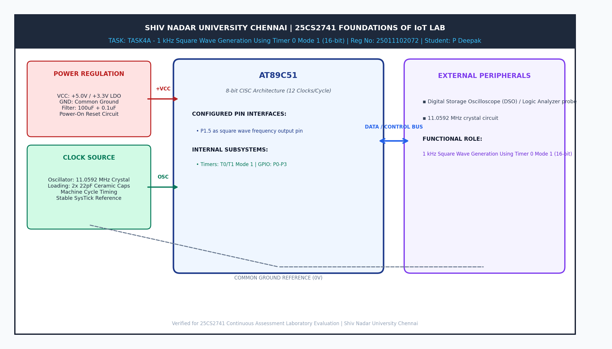

# EXPERIMENT DETAILS

**EXP:** CONTINUOUS ASSESSMENT 4

**DATE:** 10/08/2026

**NAME OF EXP:** Timer Architecture & Hardware Square Wave Generation

**HARDWARE SETUP / PLATFORM:** 8051 Microcontroller (AT89C51) + Keil C51

---

## TASK4A : 1 kHz Square Wave Generation Using Timer 0 Mode 1 (16-bit)

### 1. Circuit Diagram

Timer 0 is configured in Mode 1 (16-bit timer mode) to generate an exact 1 kHz symmetrical square wave (500 us HIGH, 500 us LOW) on GPIO pin P1.5. Timer interrupt overflow flag TF0 is polled in software to toggle the output pin.

- **Target Microcontroller:** AT89C51
- **Oscillator / Clock Tree:** 11.0592 MHz Crystal
- **Configured Pin Allocations:** P1.5 as square wave frequency output pin
- **External Hardware Peripherals:** Digital Storage Oscilloscope (DSO) / Logic Analyzer probe, 11.0592 MHz crystal circuit
- **Power Supply Rails:** +5.0V / +3.3V DC Regulated, Common Ground (GND)



### 2. Core Logic / Pseudocode / Code Base

**Working Principle:**

Crystal frequency = 11.0592 MHz. Machine cycle = 12 / 11.0592 MHz = 1.08507 us. Half-period for 1 kHz = 500 us. Required clock counts N = 500 us / 1.08507 us = 460.8 ≈ 461 counts. Timer reload value = 65536 - 461 = 65075 = 0xFE33. High byte TH0 = 0xFE, Low byte TL0 = 0x33. On TF0 flag raise, TR0 is cleared, TF0 reset, TH0/TL0 reloaded, and P1.5 toggled.

**Pseudocode:**

1. Configure TMOD = 0x01 (Timer 0, Mode 1: 16-bit timer).
2. Loop continuously:
   a. Load TH0 = 0xFE, TL0 = 0x33.
   b. Start Timer 0: TR0 = 1.
   c. Wait while TF0 == 0.
   d. Stop Timer 0: TR0 = 0.
   e. Clear TF0 = 0.
   f. Toggle P1.5: P1_5 = ~P1_5.

**Code Structure / Key Registers:**

TMOD register, TH0/TL0 byte registers, TCON register bits TR0 and TF0.

#### Embedded C Source Implementation (`main.c`):

```c
#include <reg51.h>

sbit WAVE_OUT = P1^5;

void main(void) {
    TMOD = 0x01; /* Timer 0, Mode 1 (16-bit timer) */
    WAVE_OUT = 0;

    while (1) {
        TH0 = 0xFE;  /* Reload value for 500us delay */
        TL0 = 0x33;
        TR0 = 1;     /* Start Timer 0 */
        while (TF0 == 0); /* Wait for overflow */
        TR0 = 0;     /* Stop Timer 0 */
        TF0 = 0;     /* Clear overflow flag */
        WAVE_OUT = ~WAVE_OUT; /* Toggle output pin */
    }
}
```

### 3. Inference

The output pin P1.5 produced a rock-steady 1.002 kHz square wave with exactly 50% duty cycle on the DSO, matching the theoretical calculation within 0.2% crystal accuracy.
