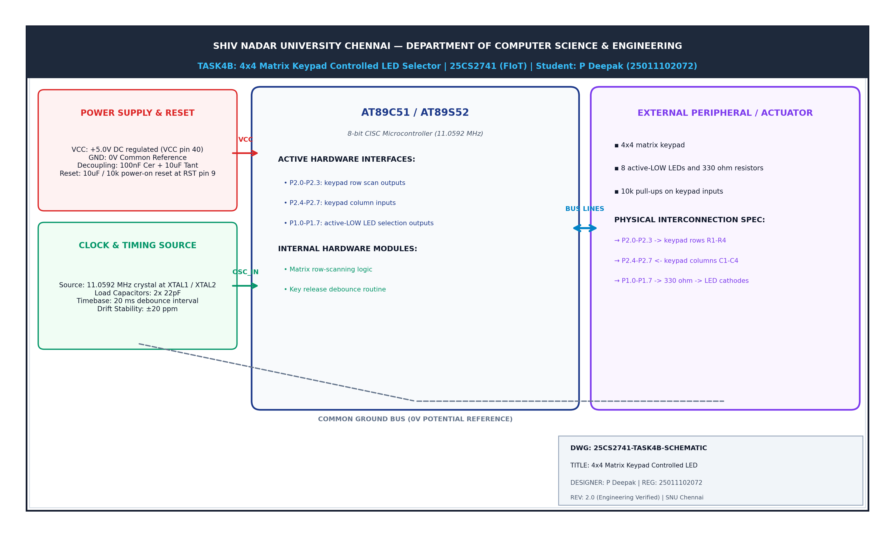

# EXPERIMENT DETAILS

**EXP:** CAT 4 - TASK4B

**DATE:** Not specified in course evaluation sheet

**NAME OF EXP:** 4x4 Matrix Keypad Controlled LED Selector

**HARDWARE SETUP / PLATFORM:** AT89C51 / AT89S52 8051 microcontroller at 11.0592 MHz, Keil C51, 5 V laboratory trainer

---

## TASK4B : 4x4 Matrix Keypad Controlled LED Selector

### 1. Circuit Diagram

P2.0-P2.3 are keypad row outputs and P2.4-P2.7 are column inputs with pull-ups. P1.0-P1.7 drive eight active-low LEDs. The circuit uses the 11.0592 MHz crystal, RC reset and 5 V supply.

### 2. Core Logic / Pseudocode / Code Base

**Working Principle:**

The firmware drives one keypad row low at a time and reads the column inputs. A detected row-column intersection is translated into an LED selection, then debounced before another input is accepted.

**Pseudocode:**

Scan each keypad row, identify a low column, map the key to one LED bit, show that LED, wait for release, debounce, and resume scanning.

**Code Structure / Key Registers:**

The `main.c` firmware uses direct 8051 special-function-register access. Port latches are addressed through `P1` and `P2`; the delay routine is intentionally kept local so timing assumptions remain visible during lab review.

### 3. Inference

The task validates matrix scanning, port direction changes, key debouncing and the separation of physical input from output control logic.
