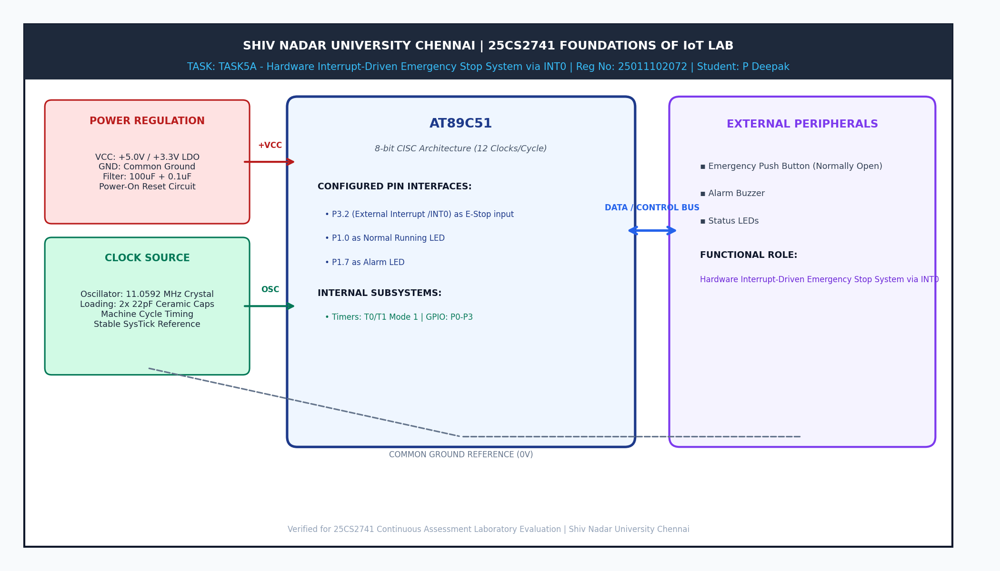

# EXPERIMENT DETAILS

**EXP:** CONTINUOUS ASSESSMENT 5

**DATE:** 17/08/2026

**NAME OF EXP:** Interrupt System Architecture & External Asynchronous Events

**HARDWARE SETUP / PLATFORM:** 8051 Microcontroller (AT89C51) + Keil C51

---

## TASK5A : Hardware Interrupt-Driven Emergency Stop System via INT0

### 1. Circuit Diagram

External Interrupt 0 (/INT0 on pin P3.2) is configured for falling-edge trigger mode (IT0 = 1). The main super-loop executes a normal background blinking pattern on P1.0. An asynchronous button press on P3.2 instantly invokes ISR vector 0x0003, interrupting normal execution to latch an emergency alarm state on P1.7.

- **Target Microcontroller:** AT89C51
- **Oscillator / Clock Tree:** 11.0592 MHz Crystal
- **Configured Pin Allocations:** P3.2 (External Interrupt /INT0) as E-Stop input; P1.0 as Normal Running LED; P1.7 as Alarm LED
- **External Hardware Peripherals:** Emergency Push Button (Normally Open), Alarm Buzzer, Status LEDs
- **Power Supply Rails:** +5.0V / +3.3V DC Regulated, Common Ground (GND)



### 2. Core Logic / Pseudocode / Code Base

**Working Principle:**

When IT0 is set to 1 in TCON, the 8051 transition detector triggers an interrupt request on a 1-to-0 transition on P3.2. The CPU finishes the current instruction, pushes PC onto the stack, and vectors to ISR address 0x0003 (interrupt 0). This provides sub-microsecond latency compared to polling.

**Pseudocode:**

1. Set IT0 = 1 in TCON (falling edge trigger for INT0).
2. Enable interrupts: EX0 = 1 (Enable External 0), EA = 1 (Global Enable).
3. In External0_ISR() interrupt 0:
   a. Set Emergency Flag.
   b. Toggle Emergency Alarm LED (P1.7).
4. In main loop:
   a. Normal background task: blink P1.0 with 300ms delay.

**Code Structure / Key Registers:**

IE register (EA, EX0), TCON register (IT0, IE0), ISR function defined with `interrupt 0` keyword.

#### Embedded C Source Implementation (`main.c`):

```c
#include <reg51.h>

sbit RUN_LED   = P1^0;
sbit ALARM_LED = P1^7;

void delay_ms(unsigned int ms) {
    unsigned int i, j;
    for (i = 0; i < ms; i++) {
        for (j = 0; j < 120; j++);
    }
}

void External0_ISR(void) interrupt 0 {
    /* Instantly serviced on falling edge at P3.2 */
    ALARM_LED = ~ALARM_LED; /* Toggle alarm status */
}

void main(void) {
    IT0 = 1; /* Configure INT0 as falling-edge triggered */
    EX0 = 1; /* Enable External Interrupt 0 */
    EA  = 1; /* Enable Global Interrupts */

    ALARM_LED = 1; /* Off (active-low) */
    while (1) {
        RUN_LED = ~RUN_LED; /* Background heartbeat */
        delay_ms(300);
    }
}
```

### 3. Inference

Asynchronous interrupt trigger provided instantaneous response to switch actuation regardless of where the main delay loop was executing, validating true preemptive event handling.
