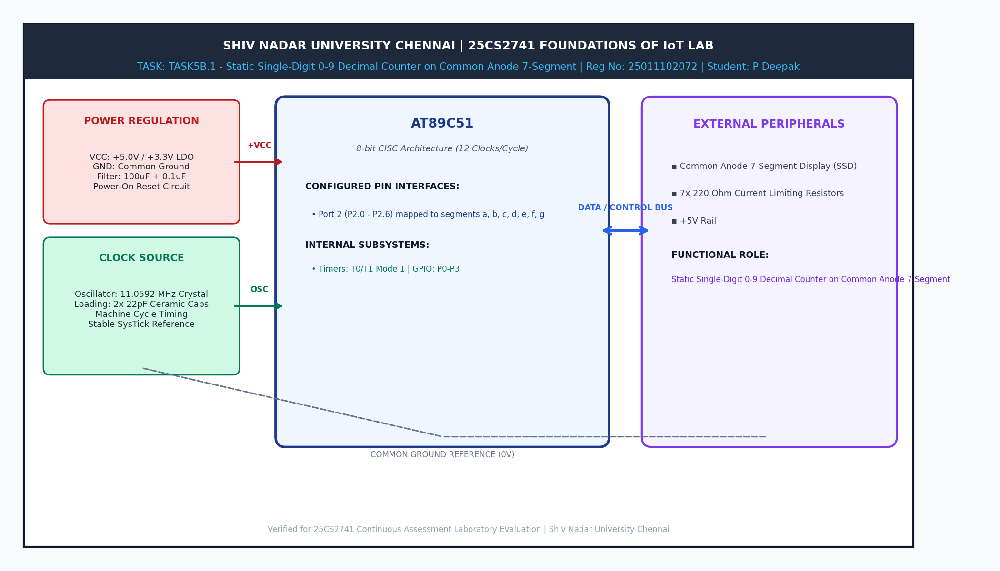

# EXPERIMENT DETAILS

**EXP:** CONTINUOUS ASSESSMENT 5

**DATE:** 17/08/2026

**NAME OF EXP:** Display Interfacing – 7-Segment Displays

**HARDWARE SETUP / PLATFORM:** 8051 Microcontroller (AT89C51) + Keil C51

---

## TASK5B.1 : Static Single-Digit 0-9 Decimal Counter on Common Anode 7-Segment

### 1. Circuit Diagram

A Common Anode 7-Segment Display is interfaced to Port 2. Segments a-g light up when driven LOW (0). A lookup table stores 7-segment hex patterns for numerals 0 through 9. The program cycles through digits 0 to 9 with a 1-second interval.

- **Target Microcontroller:** AT89C51
- **Oscillator / Clock Tree:** 11.0592 MHz Crystal
- **Configured Pin Allocations:** Port 2 (P2.0 - P2.6) mapped to segments a, b, c, d, e, f, g
- **External Hardware Peripherals:** Common Anode 7-Segment Display (SSD), 7x 220 Ohm Current Limiting Resistors, +5V Rail
- **Power Supply Rails:** +5.0V / +3.3V DC Regulated, Common Ground (GND)



### 2. Core Logic / Pseudocode / Code Base

**Working Principle:**

For Common Anode displays, the common terminal connects to +5V. Segment pins driven LOW sink current and illuminate. Table lookup: 0->0xC0, 1->0xF9, 2->0xA4, 3->0xB0, 4->0x99, 5->0x92, 6->0x82, 7->0xF8, 8->0x80, 9->0x90. Port 2 outputs each byte sequentially.

**Pseudocode:**

1. Define code array seg_code[10] = {0xC0, 0xF9, 0xA4, 0xB0, 0x99, 0x92, 0x82, 0xF8, 0x80, 0x90}.
2. In main loop:
   a. For i = 0 to 9:
      i. Write P2 = seg_code[i].
      ii. Delay 1000ms.
   b. Repeat continuously.

**Code Structure / Key Registers:**

Look-up table in code ROM space, Port 2 byte assignment.

#### Embedded C Source Implementation (`main.c`):

```c
#include <reg51.h>

/* Common Anode segment codes for numerals 0 - 9 (a=bit0 ... g=bit6) */
unsigned char code seg_code[10] = {
    0xC0, 0xF9, 0xA4, 0xB0, 0x99, 0x92, 0x82, 0xF8, 0x80, 0x90
};

void delay_ms(unsigned int ms) {
    unsigned int i, j;
    for (i = 0; i < ms; i++) {
        for (j = 0; j < 120; j++);
    }
}

void main(void) {
    unsigned char digit = 0;
    while (1) {
        for (digit = 0; digit < 10; digit++) {
            P2 = seg_code[digit];
            delay_ms(1000);
        }
    }
}
```

### 3. Inference

Numerals 0 through 9 displayed crisply with uniform brightness. Common-anode active-low segment encoding functioned reliably.
