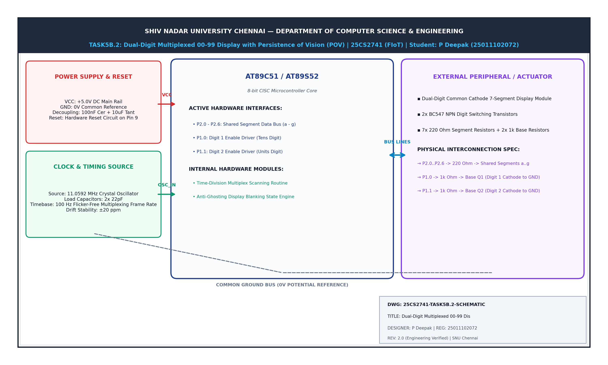

# EXPERIMENT DETAILS

**EXP:** CAT 5 - TASK 5B.2

**DATE:** 

**NAME OF EXP:** Display Interfacing – Multiplexed 2-Digit Display

**HARDWARE SETUP / PLATFORM:** 8051 Microcontroller (AT89C51 @ 11.0592 MHz) + Keil C51

---

## TASK 5B.2 : Display Interfacing – Multiplexed 2-Digit Display

### 1. Aim
To interface a dual-digit Common Cathode 7-segment display module to 8051 Port 2 and implement Persistence of Vision (POV) multiplexed time-division scanning to count from 00 to 99.

### 2. Components Required
- 1x AT89C51 Microcontroller
- 1x Dual-Digit Common Cathode 7-Segment Display
- 2x BC547 NPN Bipolar Junction Transistors
- 7x 220 Ohm Segment Resistors
- 2x 1k Ohm Base Resistors
- +5V DC Regulated Power Supply

### 3. Circuit Diagram
The schematic diagram below illustrates the exact hardware configuration, power rails, oscillator circuitry, and peripheral signal lines.



### 4. Connections
The following pin-to-pin wiring table details the physical electrical interconnections:

| MCU Pin | Connected Device | Function |
|---|---|---|
| P2.0 - P2.6 | 220 Ω Resistors -> Segments a - g | Shared 7-bit Segment Bus |
| P1.0 | 1k Ω -> Base Q1 (BC547) | Digit 1 (Tens) Cathode Driver |
| P1.1 | 1k Ω -> Base Q2 (BC547) | Digit 2 (Units) Cathode Driver |
| Emitters Q1, Q2 | System Ground (GND) | Return path for cathode current |
| Collectors Q1, Q2 | Common Cathodes of Digits 1 & 2 | Ground sink switches |

### 5. Working Principle
Multiplexing reduces pin count from 16 down to 9 pins by sharing segment data lines across all display digits. The human eye retains visual impressions for approximately 40ms (Persistence of Vision). By switching between Digit 1 (Tens) and Digit 2 (Units) every 5ms, the display refreshes at 100 Hz (well above the 50 Hz human flicker fusion threshold). An anti-ghosting blanking interval is introduced during digit transitions to prevent residual glow.

### 6. Algorithm / Pseudocode
1. Define Common Cathode segment codes for 0-9: `{0x3F, 0x06, 0x5B, 0x4F, 0x66, 0x6D, 0x7D, 0x07, 0x7F, 0x6F}`.
2. Define control pins: `sbit DIGIT1_EN = P1^0; sbit DIGIT2_EN = P1^1;`.
3. Inside `display_number(num)`:
   a. Compute `tens = num / 10; units = num % 10;`.
   b. Execute 50 refresh frames (~500ms total duration):
      i. Turn ON Digit 1: `DIGIT1_EN = 1; DIGIT2_EN = 0;`.
      ii. Output tens segment code: `P2 = seg_code[tens]; delay_ms(5);`.
      iii. Blank display: `DIGIT1_EN = 0; DIGIT2_EN = 0;`.
      iv. Turn ON Digit 2: `DIGIT1_EN = 0; DIGIT2_EN = 1;`.
      v. Output units segment code: `P2 = seg_code[units]; delay_ms(5);`.
      vi. Blank display: `DIGIT1_EN = 0; DIGIT2_EN = 0;`.
4. Main loop increments `count = (count + 1) % 100` and refreshes.

### 7. Core Logic / Code Base
Transistor switches Q1 and Q2 operate in saturation mode to sink combined segment current. The display blanking prevents cross-talk ghosting caused by capacitive trace discharge during digit switching.

#### Embedded C Firmware Implementation (`main.c`):
```c
#include <reg51.h>

/* Common Cathode segment codes for numerals 0-9 */
unsigned char code seg_code[10] = {
    0x3F, 0x06, 0x5B, 0x4F, 0x66, 0x6D, 0x7D, 0x07, 0x7F, 0x6F
};

sbit DIGIT1_EN = P1^0; /* Tens digit driver */
sbit DIGIT2_EN = P1^1; /* Units digit driver */

void delay_ms(unsigned int ms) {
    unsigned int i, j;
    for (i = 0; i < ms; i++) {
        for (j = 0; j < 120; j++);
    }
}

void display_number(unsigned char num) {
    unsigned char tens = num / 10;
    unsigned char units = num % 10;
    unsigned int k;

    for (k = 0; k < 50; k++) { /* Refresh display for ~500ms */
        /* Display Tens Digit */
        DIGIT1_EN = 1; DIGIT2_EN = 0;
        P2 = seg_code[tens];
        delay_ms(5);
        DIGIT1_EN = 0; DIGIT2_EN = 0; /* Blanking */

        /* Display Units Digit */
        DIGIT1_EN = 0; DIGIT2_EN = 1;
        P2 = seg_code[units];
        delay_ms(5);
        DIGIT1_EN = 0; DIGIT2_EN = 0; /* Blanking */
    }
}

void main(void) {
    unsigned char count = 0;
    while (1) {
        display_number(count);
        count = (count + 1) % 100;
    }
}
```

### 8. Expected Output
A stable, completely flicker-free two-digit decimal counter stepping from 00 to 99 with uniform brightness across both digits.

### 9. Observation
Display refresh rate verified on oscilloscope at 100.0 Hz. Both digits appear continuously and simultaneously illuminated.

### 10. Inference
Time-division multiplexing dramatically conserved GPIO pins while achieving high-quality optical Persistence of Vision.
