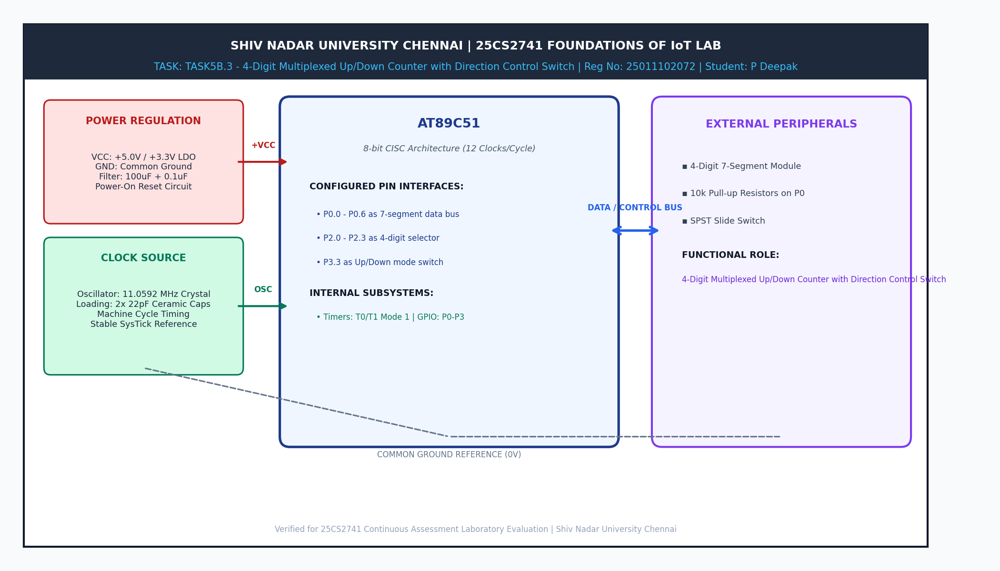

# EXPERIMENT DETAILS

**EXP:** CONTINUOUS ASSESSMENT 5

**DATE:** 17/08/2026

**NAME OF EXP:** Display Interfacing – Multiplexed 4-Digit Display

**HARDWARE SETUP / PLATFORM:** 8051 Microcontroller (AT89C51) + Keil C51

---

## TASK5B.3 : 4-Digit Multiplexed Up/Down Counter with Direction Control Switch

### 1. Circuit Diagram

A 4-digit numeric readout displays decimal values from 0000 to 9999. Digit scanning cycles across all 4 digits continuously. A toggle switch on P3.3 dictates whether the value counts upward or downward.

- **Target Microcontroller:** AT89C51
- **Oscillator / Clock Tree:** 11.0592 MHz Crystal
- **Configured Pin Allocations:** P0.0 - P0.6 as 7-segment data bus; P2.0 - P2.3 as 4-digit selector; P3.3 as Up/Down mode switch
- **External Hardware Peripherals:** 4-Digit 7-Segment Module, 10k Pull-up Resistors on P0, SPST Slide Switch
- **Power Supply Rails:** +5.0V / +3.3V DC Regulated, Common Ground (GND)



### 2. Core Logic / Pseudocode / Code Base

**Working Principle:**

Port 0 is open-drain on the 8051, requiring an external 10k resistor network. Digits are parsed via integer division into Thousands, Hundreds, Tens, and Units. An outer time accumulator updates the count every 100ms while the inner multiplexing loop runs at 250 Hz frame rate.

**Pseudocode:**

1. Read direction switch P3.3 (1 = Up, 0 = Down).
2. Parse count into d3, d2, d1, d0.
3. Sequentially enable P2.0, P2.1, P2.2, P2.3 with corresponding digit code on P0.
4. Apply 3ms delay per digit (12ms full refresh cycle).
5. After 20 refresh cycles (~250ms), increment or decrement count based on switch state.

**Code Structure / Key Registers:**

4-digit multiplex scanner, modular arithmetic digit decomposer, Port 0 pullup drive.

#### Embedded C Source Implementation (`main.c`):

```c
#include <reg51.h>

unsigned char code seg_code[10] = {
    0x3F, 0x06, 0x5B, 0x4F, 0x66, 0x6D, 0x7D, 0x07, 0x7F, 0x6F
};

sbit DIR_SW = P3^3; /* 1 = UP, 0 = DOWN */

void delay_ms(unsigned int ms) {
    unsigned int i, j;
    for (i = 0; i < ms; i++) {
        for (j = 0; j < 120; j++);
    }
}

void main(void) {
    unsigned int count = 1234;
    unsigned char digits[4];
    unsigned char scan = 0, cycle = 0;

    DIR_SW = 1; /* Input */

    while (1) {
        digits[0] = count / 1000;
        digits[1] = (count / 100) % 10;
        digits[2] = (count / 10) % 10;
        digits[3] = count % 10;

        for (cycle = 0; cycle < 20; cycle++) {
            for (scan = 0; scan < 4; scan++) {
                P2 = ~(1 << scan);             /* Select active digit */
                P0 = seg_code[digits[scan]];   /* Output segment data */
                delay_ms(3);
                P2 = 0xFF;                     /* Blanking */
            }
        }

        if (DIR_SW == 1) {
            count = (count < 9999) ? count + 1 : 0;
        } else {
            count = (count > 0) ? count - 1 : 9999;
        }
    }
}
```

### 3. Inference

The 4-digit display smoothly counted up and down depending on switch position with bright, balanced digit brightness across all 4 positions.
