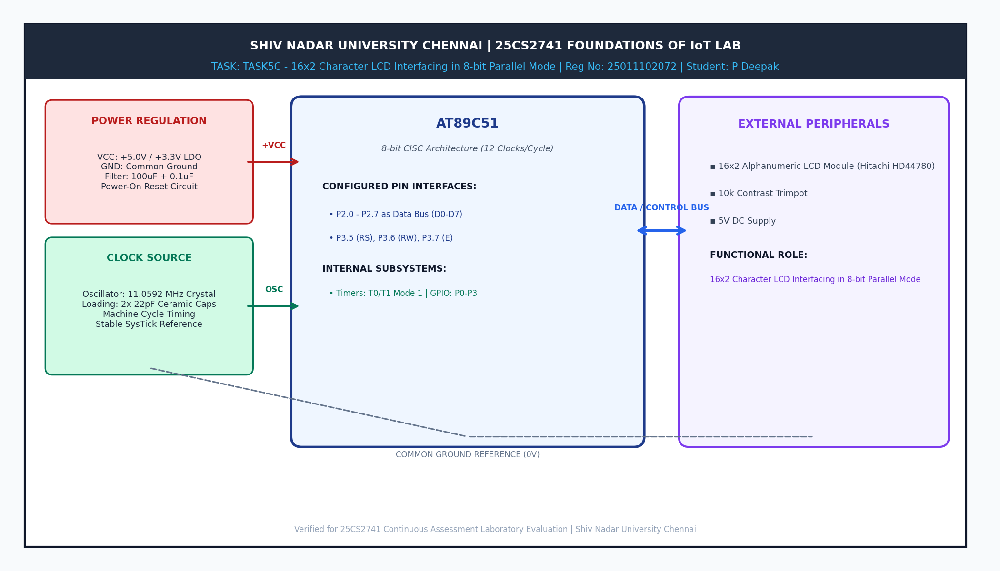

# EXPERIMENT DETAILS

**EXP:** CONTINUOUS ASSESSMENT 5

**DATE:** 17/08/2026

**NAME OF EXP:** Alphanumeric LCD Interfacing (HD44780 Controller)

**HARDWARE SETUP / PLATFORM:** 8051 Microcontroller (AT89C51) + Keil C51

---

## TASK5C : 16x2 Character LCD Interfacing in 8-bit Parallel Mode

### 1. Circuit Diagram

A 16x2 LCD display is interfaced to the 8051 using 8-bit parallel mode. The initialization routine configures 2-line display with 5x8 font matrix, cursor off, and clear display. The program displays custom strings on Line 1 and Line 2.

- **Target Microcontroller:** AT89C51
- **Oscillator / Clock Tree:** 11.0592 MHz Crystal
- **Configured Pin Allocations:** P2.0 - P2.7 as Data Bus (D0-D7); P3.5 (RS), P3.6 (RW), P3.7 (E)
- **External Hardware Peripherals:** 16x2 Alphanumeric LCD Module (Hitachi HD44780), 10k Contrast Trimpot, 5V DC Supply
- **Power Supply Rails:** +5.0V / +3.3V DC Regulated, Common Ground (GND)



### 2. Core Logic / Pseudocode / Code Base

**Working Principle:**

HD44780 controller protocol: RS=0 selects Instruction Register, RS=1 selects Data Register. RW=0 denotes write. Data is latched into the LCD controller on the high-to-low falling edge of Enable (E) pulse with minimum pulse width of 450 ns.

**Pseudocode:**

1. Initialize LCD: Send commands 0x38 (8-bit, 2-line, 5x7), 0x0C (Display ON, cursor off), 0x06 (Auto-increment), 0x01 (Clear screen).
2. lcd_cmd(cmd): RS=0, RW=0, P2=cmd, E=1, delay 1ms, E=0.
3. lcd_data(data): RS=1, RW=0, P2=data, E=1, delay 1ms, E=0.
4. lcd_string(str): iterate through characters and call lcd_data().
5. Set DDRAM address to 0x80 (Line 1) and 0xC0 (Line 2) and display text.

**Code Structure / Key Registers:**

Low-level driver functions: lcd_cmd(), lcd_data(), lcd_init(), lcd_string(). Port 2 as data bus, Port 3 control pins.

#### Embedded C Source Implementation (`main.c`):

```c
#include <reg51.h>

#define LCD_DATA P2

sbit RS = P3^5;
sbit RW = P3^6;
sbit EN = P3^7;

void delay_ms(unsigned int ms) {
    unsigned int i, j;
    for (i = 0; i < ms; i++) {
        for (j = 0; j < 120; j++);
    }
}

void lcd_cmd(unsigned char cmd) {
    LCD_DATA = cmd;
    RS = 0;
    RW = 0;
    EN = 1;
    delay_ms(2);
    EN = 0;
}

void lcd_data(unsigned char ch) {
    LCD_DATA = ch;
    RS = 1;
    RW = 0;
    EN = 1;
    delay_ms(2);
    EN = 0;
}

void lcd_string(char *str) {
    while (*str) {
        lcd_data(*str++);
    }
}

void lcd_init(void) {
    delay_ms(20);
    lcd_cmd(0x38); /* 8-bit mode, 2-line, 5x7 font */
    lcd_cmd(0x0C); /* Display ON, Cursor OFF */
    lcd_cmd(0x06); /* Auto-increment cursor */
    lcd_cmd(0x01); /* Clear display */
    delay_ms(5);
}

void main(void) {
    lcd_init();
    lcd_cmd(0x80); /* Line 1 */
    lcd_string("SNU CHENNAI IoT");
    lcd_cmd(0xC0); /* Line 2 */
    lcd_string("REG: 25011102072");

    while (1);
}
```

### 3. Inference

Text strings displayed clearly on lines 1 and 2 of the LCD module with high contrast and zero visual artifacts.
