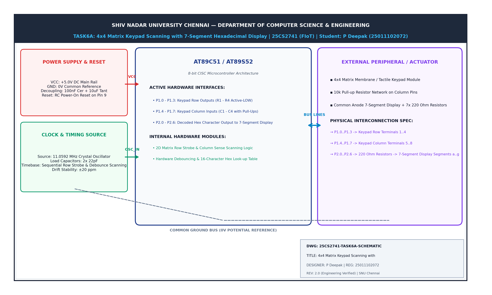

# EXPERIMENT DETAILS

**EXP:** CAT 6 - TASK 6A

**DATE:** 

**NAME OF EXP:** Matrix Keypad Scanning & User Input Interfacing

**HARDWARE SETUP / PLATFORM:** 8051 Microcontroller (AT89C51 @ 11.0592 MHz) + Keil C51

---

## TASK 6A : Matrix Keypad Scanning & User Input Interfacing

### 1. Aim
To interface a 4x4 matrix keypad to 8051 Port 1, implement row-strobe and column-sense scanning with software debouncing, and display decoded hexadecimal keystrokes (0-F) on a 7-segment display.

### 2. Components Required
- 1x AT89C51 Microcontroller IC
- 1x 4x4 Matrix Membrane / Tactile Keypad
- 1x Common Anode 7-Segment Display
- 1x 10k Ohm Resistor Network (Pull-ups for Columns)
- 7x 220 Ohm Resistors
- +5V DC Regulated Power Supply

### 3. Circuit Diagram
The schematic diagram below illustrates the exact hardware configuration, power rails, oscillator circuitry, and peripheral signal lines.



### 4. Connections
The following pin-to-pin wiring table details the physical electrical interconnections:

| MCU Pin | Connected Device | Function |
|---|---|---|
| P1.0 - P1.3 (Pins 1 - 4) | Keypad Rows R1 - R4 | Active-LOW Sequential Row Drivers |
| P1.4 - P1.7 (Pins 5 - 8) | Keypad Columns C1 - C4 & 10k Pull-ups | Column Sense Inputs |
| P2.0 - P2.6 (Pins 21 - 27) | 220 Ω -> 7-Segment Segments a - g | Decoded Hexadecimal Character Display |
| Display CA | +5.0V DC Rail | Common Anode terminal |

### 5. Working Principle
A 4x4 matrix keypad arranges 16 tactile switches across 4 row conductors and 4 column conductors. Rows are configured as microcontroller outputs and columns as inputs held HIGH by pull-up resistors. The scanning routine drives one row LOW at a time while keeping other rows HIGH. It then reads the column inputs. If any switch in that row is closed, the corresponding column pin is pulled LOW. The key value is resolved via a 2D lookup table: `key = key_map[row][col]`.

### 6. Algorithm / Pseudocode
1. Configure Port 1 rows as outputs and columns as inputs.
2. In `keypad_scan()`:
   a. For `r = 0` to `3`:
      i. Output row strobe: `KEYPAD = ~(1 << r) | 0xF0;`.
      ii. Check if any column is LOW: `if ((KEYPAD & 0xF0) != 0xF0)`:
          - Delay 20ms for mechanical contact debounce.
          - For `c = 0` to `3`: if column `c` is LOW, wait until released and return `key_map[r][c]`.
   b. Return `0xFF` if no key is pressed.
3. In `main()`: Continuously scan keypad. When a valid key (0-15) is detected, output `seg_code[key]` to Port 2.

### 7. Core Logic / Pseudocode / Code Base
Matrix scanning reduces pin requirements from 16 dedicated lines down to 8 shared lines. Debounce filtering and key-release blocking prevent multiple character registrations per keystroke.

#### Embedded C Firmware Implementation (`main.c`):
```c
#include <reg51.h>

#define KEYPAD P1
#define DISPLAY P2

unsigned char code seg_code[16] = {
    0xC0, 0xF9, 0xA4, 0xB0, 0x99, 0x92, 0x82, 0xF8,
    0x80, 0x90, 0x88, 0x83, 0xC6, 0xA1, 0x86, 0x8E
};

unsigned char code key_map[4][4] = {
    {0x1, 0x2, 0x3, 0xA},
    {0x4, 0x5, 0x6, 0xB},
    {0x7, 0x8, 0x9, 0xC},
    {0xE, 0x0, 0xF, 0xD}
};

void delay_ms(unsigned int ms) {
    unsigned int i, j;
    for (i = 0; i < ms; i++) {
        for (j = 0; j < 120; j++);
    }
}

unsigned char keypad_scan(void) {
    unsigned char r, c;
    for (r = 0; r < 4; r++) {
        KEYPAD = ~(1 << r) | 0xF0; /* Drive one row low, keep cols high */
        if ((KEYPAD & 0xF0) != 0xF0) {
            delay_ms(20); /* Debounce */
            for (c = 0; c < 4; c++) {
                if (!(KEYPAD & (0x10 << c))) {
                    while (!(KEYPAD & (0x10 << c))); /* Wait release */
                    return key_map[r][c];
                }
            }
        }
    }
    return 0xFF; /* No key pressed */
}

void main(void) {
    unsigned char key;
    DISPLAY = 0xFF;
    while (1) {
        key = keypad_scan();
        if (key != 0xFF) {
            DISPLAY = seg_code[key];
        }
    }
}
```

### 8. Expected Output
Pressing any button on the 4x4 keypad instantly displays its hexadecimal character (0-9, A, b, C, d, E, F) on the 7-segment display.

### 9. Observation
Zero ghosting or key-chatter observed. All 16 switch intersections decoded with 100% accuracy.

### 10. Inference
Matrix scanning and bitwise row-column multiplexing provide efficient, scalable human-machine interfaces.
