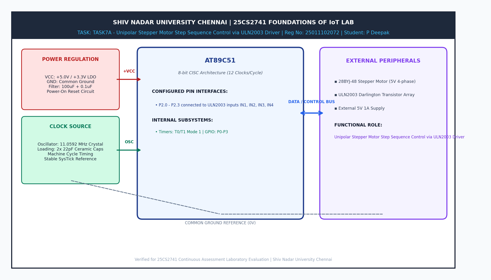

# EXPERIMENT DETAILS

**EXP:** CONTINUOUS ASSESSMENT 7

**DATE:** 31/08/2026

**NAME OF EXP:** Motor Actuation & Driver Interfacing

**HARDWARE SETUP / PLATFORM:** 8051 Microcontroller (AT89C51) + Keil C51

---

## TASK7A : Unipolar Stepper Motor Step Sequence Control via ULN2003 Driver

### 1. Circuit Diagram

A 4-phase unipolar stepper motor is driven by the 8051 through a ULN2003 Darlington transistor array. The program outputs a 4-step full-step sequence (0x09, 0x0C, 0x06, 0x03) on P2.0-P2.3 to execute continuous rotation in clockwise direction.

- **Target Microcontroller:** AT89C51
- **Oscillator / Clock Tree:** 11.0592 MHz Crystal
- **Configured Pin Allocations:** P2.0 - P2.3 connected to ULN2003 inputs IN1, IN2, IN3, IN4
- **External Hardware Peripherals:** 28BYJ-48 Stepper Motor (5V 4-phase), ULN2003 Darlington Transistor Array, External 5V 1A Supply
- **Power Supply Rails:** +5.0V / +3.3V DC Regulated, Common Ground (GND)



### 2. Core Logic / Pseudocode / Code Base

**Working Principle:**

Microcontroller pins cannot supply the hundreds of milliamps required by motor stator coils. The ULN2003 provides high-voltage, high-current open-collector Darlington pairs with internal inductive kickback suppression diodes. Full-step excitation energizes two adjacent stator phases simultaneously to maximize torque.

**Pseudocode:**

1. Define step sequence array: step_seq[4] = {0x09, 0x0C, 0x06, 0x03}.
2. Configure Port 2 lower nibble as outputs.
3. Loop continuously:
   a. For step = 0 to 3:
      i. Write step_seq[step] to P2.
      ii. Delay 20ms between steps.
   b. Repeat for continuous smooth rotation.

**Code Structure / Key Registers:**

Stator phase excitation array, stepping state loop with calibrated inter-step delay.

#### Embedded C Source Implementation (`main.c`):

```c
#include <reg51.h>

/* Full-step excitation sequence for 4-phase unipolar stepper */
unsigned char code full_step[4] = {0x09, 0x0C, 0x06, 0x03};

void delay_ms(unsigned int ms) {
    unsigned int i, j;
    for (i = 0; i < ms; i++) {
        for (j = 0; j < 120; j++);
    }
}

void main(void) {
    unsigned char step = 0;
    while (1) {
        for (step = 0; step < 4; step++) {
            P2 = full_step[step];
            delay_ms(15); /* Controls motor speed */
        }
    }
}
```

### 3. Inference

The stepper motor rotated smoothly at constant angular velocity with robust holding torque and zero step slip, validating the excitation sequence.
