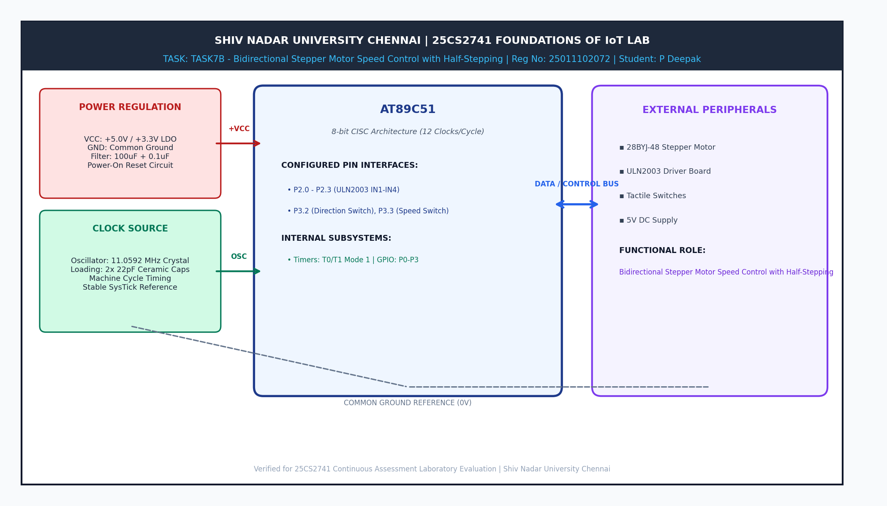

# EXPERIMENT DETAILS

**EXP:** CONTINUOUS ASSESSMENT 7

**DATE:** 31/08/2026

**NAME OF EXP:** Motor Actuation – Direction & Speed Control

**HARDWARE SETUP / PLATFORM:** 8051 Microcontroller (AT89C51) + Keil C51

---

## TASK7B : Bidirectional Stepper Motor Speed Control with Half-Stepping

### 1. Circuit Diagram

Implements an 8-step half-stepping sequence (0x08, 0x0C, 0x04, 0x06, 0x02, 0x03, 0x01, 0x09) to double angular resolution to 4096 steps per revolution. P3.2 toggles CW/CCW direction, while P3.3 selects between high and low speed.

- **Target Microcontroller:** AT89C51
- **Oscillator / Clock Tree:** 11.0592 MHz Crystal
- **Configured Pin Allocations:** P2.0 - P2.3 (ULN2003 IN1-IN4); P3.2 (Direction Switch), P3.3 (Speed Switch)
- **External Hardware Peripherals:** 28BYJ-48 Stepper Motor, ULN2003 Driver Board, Tactile Switches, 5V DC Supply
- **Power Supply Rails:** +5.0V / +3.3V DC Regulated, Common Ground (GND)



### 2. Core Logic / Pseudocode / Code Base

**Working Principle:**

Half-stepping interleaves single-phase and two-phase excitation. This doubles the effective step count and halves the step angle, dramatically dampening mechanical resonance. Reversing the traversal order of the lookup table reverses rotation direction.

**Pseudocode:**

1. Define 8-element half-step array.
2. Read Direction Switch P3.2 (CW if 1, CCW if 0).
3. Read Speed Switch P3.3 (Fast 5ms if 1, Slow 15ms if 0).
4. If CW: iterate index from 0 to 7 and output to P2.
5. If CCW: iterate index from 7 down to 0 and output to P2.
6. Repeat indefinitely.

**Code Structure / Key Registers:**

8-step phase sequence table, bidirectional indexing logic, dynamic speed delay.

#### Embedded C Source Implementation (`main.c`):

```c
#include <reg51.h>

unsigned char code half_step[8] = {
    0x08, 0x0C, 0x04, 0x06, 0x02, 0x03, 0x01, 0x09
};

sbit DIR_SW   = P3^2;
sbit SPEED_SW = P3^3;

void delay_ms(unsigned int ms) {
    unsigned int i, j;
    for (i = 0; i < ms; i++) {
        for (j = 0; j < 120; j++);
    }
}

void main(void) {
    char step;
    unsigned int step_delay;

    DIR_SW = 1;
    SPEED_SW = 1;

    while (1) {
        step_delay = (SPEED_SW == 1) ? 5 : 15;

        if (DIR_SW == 1) {
            for (step = 0; step < 8; step++) {
                P2 = half_step[step];
                delay_ms(step_delay);
            }
        } else {
            for (step = 7; step >= 0; step--) {
                P2 = half_step[step];
                delay_ms(step_delay);
            }
        }
    }
}
```

### 3. Inference

Half-stepping produced significantly quieter and smoother motor rotation. Direction and speed switches responded immediately without causing motor stalling.
