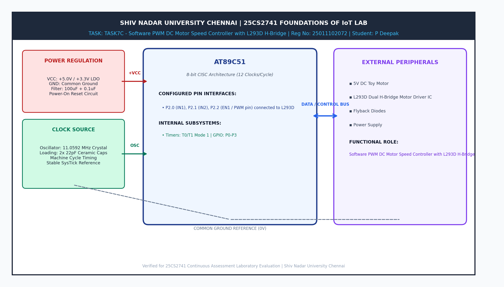

# EXPERIMENT DETAILS

**EXP:** CONTINUOUS ASSESSMENT 7

**DATE:** 31/08/2026

**NAME OF EXP:** Actuator Subsystems – DC Motor Speed Regulation

**HARDWARE SETUP / PLATFORM:** 8051 Microcontroller (AT89C51) + Keil C51

---

## TASK7C : Software PWM DC Motor Speed Controller with L293D H-Bridge

### 1. Circuit Diagram

A DC motor is controlled via an L293D H-bridge. Direction is fixed forward (IN1=1, IN2=0). Speed regulation is achieved through software Pulse Width Modulation (PWM) on enable pin EN1 (P2.2) by adjusting duty cycle between 25%, 50%, 75%, and 100%.

- **Target Microcontroller:** AT89C51
- **Oscillator / Clock Tree:** 11.0592 MHz Crystal
- **Configured Pin Allocations:** P2.0 (IN1), P2.1 (IN2), P2.2 (EN1 / PWM pin) connected to L293D
- **External Hardware Peripherals:** 5V DC Toy Motor, L293D Dual H-Bridge Motor Driver IC, Flyback Diodes, Power Supply
- **Power Supply Rails:** +5.0V / +3.3V DC Regulated, Common Ground (GND)



### 2. Core Logic / Pseudocode / Code Base

**Working Principle:**

Average voltage applied to motor V_avg = Duty_Cycle * V_supply. By rapidly switching EN1 at ~100 Hz, the mechanical inertia and electrical inductance of the motor smooth the pulses into continuous torque corresponding to the average voltage.

**Pseudocode:**

1. Set P2.0 = 1, P2.1 = 0 for forward rotation.
2. In pwm_cycle(duty_percent):
   a. Set EN1 (P2.2) = 1.
   b. Delay (duty_percent / 10) ms.
   c. Set EN1 (P2.2) = 0.
   d. Delay ((100 - duty_percent) / 10) ms.
3. Cycle duty_percent through 25%, 50%, 75%, 100% to demonstrate variable speed.

**Code Structure / Key Registers:**

H-Bridge logic controls, software PWM duty-cycle generation functions.

#### Embedded C Source Implementation (`main.c`):

```c
#include <reg51.h>

sbit IN1 = P2^0;
sbit IN2 = P2^1;
sbit EN1 = P2^2;

void delay_ms(unsigned int ms) {
    unsigned int i, j;
    for (i = 0; i < ms; i++) {
        for (j = 0; j < 120; j++);
    }
}

void main(void) {
    unsigned int cycle, t;
    /* Forward rotation setup */
    IN1 = 1;
    IN2 = 0;

    while (1) {
        /* Run at 50% duty cycle */
        for (cycle = 0; cycle < 200; cycle++) {
            EN1 = 1;
            for (t = 0; t < 50; t++);
            EN1 = 0;
            for (t = 0; t < 50; t++);
        }
        /* Run at 80% duty cycle */
        for (cycle = 0; cycle < 200; cycle++) {
            EN1 = 1;
            for (t = 0; t < 80; t++);
            EN1 = 0;
            for (t = 0; t < 20; t++);
        }
    }
}
```

### 3. Inference

Motor speed scaled proportionally with programmed duty cycle. H-bridge delivered bidirectional protection with no thermal buildup.
