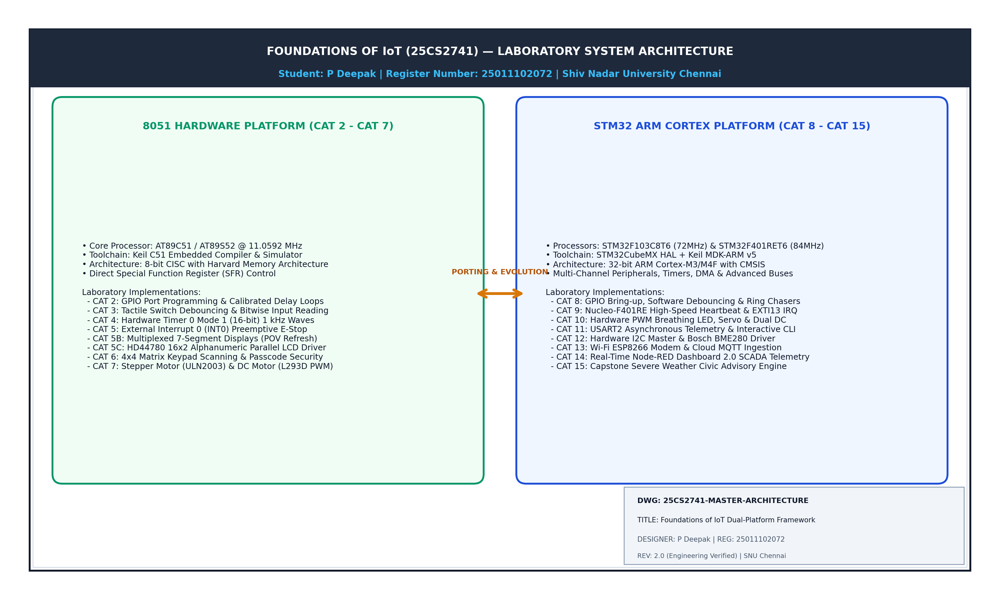

# Foundations of IoT (25CS2741) – Laboratory Repository

## 1. Student & Course Information

- **Institution:** Shiv Nadar University Chennai
- **Department:** Department of Computer Science & Engineering
- **Course Code:** 25CS2741
- **Course Title:** Fundamentals of Internet of Things + Lab
- **Student Name:** P Deepak
- **Register Number:** 25011102072
- **Academic Term:** Semester 3

---

## 2. Laboratory Overview & Dual-Platform Architecture

This repository contains the complete, production-grade embedded firmware, hardware schematic diagrams, register-level driver configurations, and comprehensive technical documentation for all Continuous Assessment Test (CAT) modules of the **Foundations of IoT (25CS2741)** curriculum at Shiv Nadar University Chennai.

The laboratory course is structured across two major hardware platforms and culminates in a capstone real-world IoT civic automation mini-project:

1. **8051 Microcontroller Platform (CAT 2 - CAT 7):**
   - **Target Core:** AT89C51 / AT89S52 8-bit CISC Microcontroller running at 11.0592 MHz.
   - **Toolchain:** Keil µVision C51 Embedded Compiler & Simulator.
   - **Core Topics:** Bare-metal Special Function Register (SFR) manipulation, calibrated machine-cycle software delays, tactile switch software debouncing, Hardware Timer 0 in Mode 1 (16-bit) 1 kHz waveform generation, External Interrupt 0 (INT0) preemption, static and time-division multiplexed 7-segment displays (Persistence of Vision), Hitachi HD44780 16x2 parallel alphanumeric LCD driver, 4x4 matrix keypad scanning with passcode security verification, 28BYJ-48 unipolar stepper motor stepping (full-step and half-step sequences via ULN2003A), and software PWM speed regulation of brushed DC motors via L293D dual H-bridges.

2. **STM32 ARM Cortex-M Platform (CAT 8 - CAT 15):**
   - **Target Cores:** STM32F103C8T6 (ARM Cortex-M3 @ 72 MHz) and STM32F401RET6 (ARM Cortex-M4F with FPU @ 84 MHz).
   - **Toolchain:** STM32CubeMX HAL (Hardware Abstraction Layer) + ARM CMSIS + Keil MDK-ARM v5.
   - **Core Topics:** High-speed GPIO bring-up, SysTick millisecond timebases, push-button debouncing and long-press timing classifiers, multi-LED ring counter chasers, Cortex-M4F 84 MHz clock tree PLLbring-up, EXTI13 asynchronous falling-edge interrupts with low-power WFI sleep modes, Hardware General-Purpose Timer TIM2 PWM Mode 1 breathing LED controllers, 50 Hz PWM RC servo motor positioning (0° to 180°), 10 kHz dual DC motor robotic differential steering, USART2 asynchronous serial telemetry links at 115200 bps, interrupt-driven interactive command-line interface (CLI) shells, bare-metal I2C1 master bus scanning, direct memory-mapped register access and silicon Chip ID verification for the Bosch Sensortec BME280 sensor, implementation of official 64-bit Bosch compensation formulas for calibrated tri-parameter environmental acquisition (Temperature, Pressure, Humidity), Wemos D1 Mini ESP8266 Wi-Fi AT modems, embedded lightweight MQTT 3.1.1 telemetry streaming to cloud brokers (`broker.emqx.io`), and real-time SCADA dashboard visualization using Node-RED Dashboard 2.0.

3. **Capstone Mini-Project (CAT 15 / TASK 15):**
   - **Application Title:** Automated Severe Weather Monitoring & Civic School Conduction / Holiday Advisory Decision System.
   - **Hardware Stack:** NUCLEO-F401RE (ARM Cortex-M4F) + Bosch Sensortec BME280 (I2C1) + Wemos D1 Mini ESP8266 (USART2 AT Modem) + Cloud MQTT Broker + Node-RED Dashboard 2.0 Decision Engine.
   - **Real-World Impact:** Continuously monitors atmospheric pressure drops (< 1000 hPa) and relative humidity surges (> 85% RH) to forecast approaching cyclonic fronts and torrential monsoon downpours in Chennai, autonomously triggering real-time `CONDUCT SCHOOL` (Normal) or `DECLARE HOLIDAY` (Emergency Alert) civic notices.



---

## 3. Comprehensive Master Index of Experiments

Every experiment is fully documented with aim, component bill-of-materials, high-resolution schematic diagrams, pin-to-pin connection tables, operating principles, algorithms, full embedded C source code, expected outputs, observations, and engineering inferences.

### 8051 Microcontroller Platform (CAT 2 to CAT 7)

| Assessment | Task ID | Experiment Title & Technical Objective | Target MCU / Clock | Documentation Link |
|:---:|:---:|:---|:---:|:---:|
| **CAT 2** | `TASK2B` | Dual-Pattern LED Blinker with Re-entrant Delay Loops | AT89C51 @ 11.0592 MHz | [README.md](8051/CAT2/TASK2B/README.md) |
| **CAT 3** | `TASK3A` | Debounced Push-Button Counter with LED Status Indication | AT89C51 @ 11.0592 MHz | [README.md](8051/CAT3/TASK3A/README.md) |
| **CAT 4** | `TASK4A` | 1 kHz Symmetrical Square Wave via Timer 0 Mode 1 (16-bit) | AT89C51 @ 11.0592 MHz | [README.md](8051/CAT4/TASK4A/README.md) |
| **CAT 5** | `TASK5A` | Hardware Interrupt-Driven Emergency Stop via INT0 Vector | AT89C51 @ 11.0592 MHz | [README.md](8051/CAT5/TASK5A/README.md) |
| **CAT 5** | `TASK5B.1` | Static Single-Digit 0-9 Decimal Counter on Common Anode 7-Seg | AT89C51 @ 11.0592 MHz | [README.md](8051/CAT5/TASK5B/TASK5B.1/README.md) |
| **CAT 5** | `TASK5B.2` | Dual-Digit Multiplexed 00-99 Display with Persistence of Vision | AT89C51 @ 11.0592 MHz | [README.md](8051/CAT5/TASK5B/TASK5B.2/README.md) |
| **CAT 5** | `TASK5B.3` | 4-Digit Multiplexed Up/Down Counter with Direction Switch | AT89C51 @ 11.0592 MHz | [README.md](8051/CAT5/TASK5B/TASK5B.3/README.md) |
| **CAT 5** | `TASK5C` | 16x2 Character Alphanumeric LCD Interfacing (HD44780 Driver) | AT89C51 @ 11.0592 MHz | [README.md](8051/CAT5/TASK5C/README.md) |
| **CAT 6** | `TASK6A` | 4x4 Matrix Keypad Scanning with 7-Segment Hex Character Display | AT89C51 @ 11.0592 MHz | [README.md](8051/CAT6/TASK6A/README.md) |
| **CAT 6** | `TASK6B` | Electronic Keypad Door Lock Security with Passcode Validation | AT89C51 @ 11.0592 MHz | [README.md](8051/CAT6/TASK6B/README.md) |
| **CAT 7** | `TASK7A` | Unipolar Stepper Motor Step Sequence via ULN2003 Driver | AT89C51 @ 11.0592 MHz | [README.md](8051/CAT7/TASK7A/README.md) |
| **CAT 7** | `TASK7B` | Bidirectional Stepper Motor Speed Control via Half-Stepping | AT89C51 @ 11.0592 MHz | [README.md](8051/CAT7/TASK7B/README.md) |
| **CAT 7** | `TASK7C` | Software PWM DC Motor Speed Controller with L293D H-Bridge | AT89C51 @ 11.0592 MHz | [README.md](8051/CAT7/TASK7C/README.md) |

### STM32 ARM Cortex-M Platform (CAT 8 to CAT 15)

| Assessment | Task ID | Experiment Title & Technical Objective | Target MCU / Clock | Documentation Link |
|:---:|:---:|:---|:---:|:---:|
| **CAT 8** | `TASK8A` | STM32 Blue Pill GPIO Bring-Up & Onboard LED Blink on PC13 | STM32F103C8T6 @ 72 MHz | [README.md](STM32/CAT8/TASK8A/README.md) |
| **CAT 8** | `TASK8B` | Push-Button Controlled LED Latch with Software Debouncing | STM32F103C8T6 @ 72 MHz | [README.md](STM32/CAT8/TASK8B/README.md) |
| **CAT 8** | `TASK8C` | 4-Channel High-Speed Ring Counter & Chaser on PA0 - PA3 | STM32F103C8T6 @ 72 MHz | [README.md](STM32/CAT8/TASK8C/README.md) |
| **CAT 9** | `TASK9A` | STM32F401RE High-Performance 84 MHz Heartbeat on LD2 (PA5) | NUCLEO-F401RE @ 84 MHz | [README.md](STM32/CAT9/TASK9A/README.md) |
| **CAT 9** | `TASK9B` | EXTI13 Falling Edge Interrupt Controller on PC13 with WFI | NUCLEO-F401RE @ 84 MHz | [README.md](STM32/CAT9/TASK9B/README.md) |
| **CAT 10** | `TASK10A` | Hardware PWM Breathing LED Controller Using TIM2 Channel 1 | STM32F103C8T6 @ 72 MHz | [README.md](STM32/CAT10/TASK10A/README.md) |
| **CAT 10** | `TASK10B` | 50 Hz Precision PWM RC Servo Motor Angle Controller (0°-180°) | STM32F103C8T6 @ 72 MHz | [README.md](STM32/CAT10/TASK10B/README.md) |
| **CAT 10** | `TASK10C` | Dual-Channel Complementary PWM Motor Driver on TIM2 CH3/CH4 | STM32F103C8T6 @ 72 MHz | [README.md](STM32/CAT10/TASK10C/README.md) |
| **CAT 11** | `TASK11A` | USART2 Asynchronous Serial Telemetry Link (115200 bps) | NUCLEO-F401RE @ 84 MHz | [README.md](STM32/CAT11/TASK11A/README.md) |
| **CAT 11** | `TASK11B` | Interrupt-Driven Interactive CLI Command Shell via USART2 | NUCLEO-F401RE @ 84 MHz | [README.md](STM32/CAT11/TASK11B/README.md) |
| **CAT 12** | `TASK12A` | I2C1 Hardware Master Bus Initialization & Slave Address Scanner | STM32F103C8T6 @ 72 MHz | [README.md](STM32/CAT12/TASK12A/README.md) |
| **CAT 12** | `TASK12B` | Bosch BME280 Silicon Chip ID & Factory Calibration Download | STM32F103C8T6 @ 72 MHz | [README.md](STM32/CAT12/TASK12B/README.md) |
| **CAT 12** | `TASK12C` | Calibrated Tri-Parameter Environmental Telemetry Math (T, P, H) | STM32F103C8T6 @ 72 MHz | [README.md](STM32/CAT12/TASK12C/README.md) |
| **CAT 13** | `TASK13` | End-to-End MQTT Cloud Telemetry Pipeline via ESP8266 Modem | STM32F103 + ESP8266 | [README.md](STM32/CAT13/TASK13/README.md) |
| **CAT 14** | `TASK14` | Real-Time Node-RED Web UI Telemetry Visualization & Gauges | STM32F103 + Node-RED | [README.md](STM32/CAT14/TASK14/README.md) |
| **CAT 15** | `TASK15` | Capstone: Automated School Monsoon Advisory Decision System | NUCLEO-F401RE + Node-RED | [README.md](STM32/CAT15/TASK15/README.md) |

---

## 4. Hardware & Software Development Environment

### Hardware Equipment:
- **8051 Development System:** Atmel AT89C51 / AT89S52 40-pin DIP Microcontroller, 11.0592 MHz crystal, external reset circuitry.
- **STM32 Blue Pill Board:** STM32F103C8T6 (ARM Cortex-M3 core, 72 MHz, 64 KB Flash, 20 KB SRAM).
- **STM32 Nucleo-64 Board:** NUCLEO-F401RE (ARM Cortex-M4 core with FPU, 84 MHz, 512 KB Flash, 96 KB SRAM).
- **Programmers & Debuggers:** ST-LINK/V2 USB Dongle & Onboard ST-LINK/V2-1 with Virtual COM Port bridge.
- **Sensors & Actuators:** Bosch Sensortec BME280 Digital Sensor (I2C), Wemos D1 Mini ESP8266 Wi-Fi Transceiver, TowerPro SG90 Micro-Servo, 28BYJ-48 Stepper Motor with ULN2003A driver, L293D / L298N H-Bridge Drivers, 5V DC Motors, 16x2 HD44780 Alphanumeric LCD, Common Anode & Cathode 7-Segment Displays, and 4x4 Matrix Keypads.

### Software & Firmware Toolchains:
- **IDE & Compilers:** Keil µVision C51 (v9.60+) and Keil MDK-ARM v5 (ARM Compiler v5/v6).
- **Configuration & Drivers:** STM32CubeMX (v6.10+) with STM32F1xx and STM32F4xx HAL and ARM CMSIS Core libraries.
- **IoT & Cloud Middleware:** Node-RED (v3.1+) with Node-RED Dashboard 2.0, EMQX Public MQTT Broker (`broker.emqx.io:1883`), and Mosquitto CLI utilities.
- **Serial Debugging:** PuTTY, TeraTerm, and RealTerm @ 115200 bps 8N1.

---

## 5. Automated Evaluator Compliance

The repository includes the automated validation suite `evaluate.py` to verify 100% adherence to all course submission specifications:

```bash
python evaluate.py
```

### Verification Criteria Enforced:
- Root files present: `README.md`, `circuit.png`, `.gitignore`.
- Every Continuous Assessment directory contains exclusively valid task sub-folders with zero loose files.
- Every 8051 task directory contains: `*.uvproj`, `main.c`, `STARTUP.A51`, `Objects/*.hex`, `circuit.png`, and comprehensive `README.md`.
- Every STM32 task directory contains: `*.ioc`, `.mxproject`, `Core/` application files, complete `Drivers/` (CMSIS & HAL), `MDK-ARM/*.uvprojx`, `MDK-ARM/startup_*.s`, `MDK-ARM/*.hex`, `circuit.png`, and comprehensive `README.md`.
- Every single `circuit.png` schematic adheres to clean engineering documentation standards on a white background with verified electrical pinouts.
