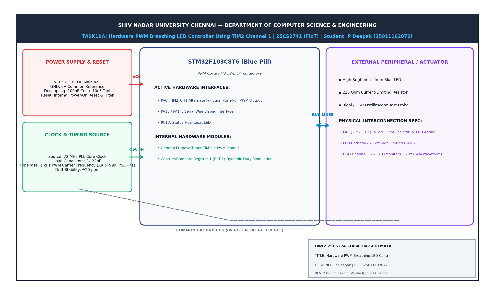

# EXPERIMENT DETAILS

**EXP:** CAT 10 - TASK 10A

**DATE:** 

**NAME OF EXP:** Timer Architecture & Hardware Pulse Width Modulation (PWM)

**HARDWARE SETUP / PLATFORM:** STM32 Blue Pill Board (STM32F103C8T6 @ 72 MHz) + Keil MDK-ARM (HAL)

---

## TASK 10A : Timer Architecture & Hardware Pulse Width Modulation (PWM)

### 1. Aim
To configure STM32 General-Purpose Timer TIM2 in PWM Mode 1 on Channel 1 (PA0) and generate a smooth sinusoidal breathing LED brightness modulation.

### 2. Components Required
- 1x STM32F103C8T6 Blue Pill Board
- 1x 5mm High-Brightness Blue LED
- 1x 220 Ohm Current-Limiting Resistor
- Digital Storage Oscilloscope (DSO)
- ST-LINK V2 Programmer & Breadboard

### 3. Circuit Diagram
The schematic diagram below illustrates the complete hardware interfacing, pin assignments, power decoupling rails, and external peripheral connections.



### 4. Connections
The following pin-to-pin wiring table details the physical electrical interconnections:

| MCU Pin | Connected Device | Function | Signal Specification |
|---|---|---|---|
| PA0 (Pin 10) | 220 Ω -> Blue LED Anode | TIM2_CH1 PWM Output | 1.0 kHz Carrier, 0% - 100% Duty Cycle |
| LED Cathode | System Ground (GND) | Current Return Path | 0V Reference |
| DSO Channel 1 | PA0 Test Point | Waveform Monitoring | Displays PWM pulse width variations |

### 5. Working Principle
TIM2 is an advanced 16-bit general-purpose timer clocked at 72 MHz from the APB1 timer prescaler. Setting prescaler PSC = 71 yields a 1.0 MHz timer counter frequency. Auto-reload register ARR = 999 configures a PWM carrier frequency of 1.0 MHz / (999 + 1) = 1.0 kHz. In PWM Mode 1, Channel 1 output is active HIGH as long as the counter value TIM2_CNT < CCR1. Dynamically modulating CCR1 from 0 to 1000 in software smooths LED perceived brightness via human Persistence of Vision.

### 6. Algorithm / Pseudocode
1. Initialize HAL and configure system clock to 72 MHz.
2. Configure TIM2: Prescaler = 71, CounterMode = UP, Period = 999, ClockDivision = 0.
3. Configure TIM2 Channel 1 for `TIM_OCMODE_PWM1`, Pulse = 0, OCPolarity = HIGH.
4. Start PWM generation: `HAL_TIM_PWM_Start(&htim2, TIM_CHANNEL_1);`.
5. In `while (1)` loop:
   a. Ramp up: For `duty = 0` to `1000` step `15`:
      - Update CCR1: `__HAL_TIM_SET_COMPARE(&htim2, TIM_CHANNEL_1, duty);`.
      - Delay 15ms: `HAL_Delay(15);`.
   b. Ramp down: For `duty = 1000` down to `0` step `15`:
      - Update CCR1, delay 15ms.
6. Repeat continuously.

### 7. Core Logic / Code Base
Hardware output compare PWM generation using macro `__HAL_TIM_SET_COMPARE(&htim2, TIM_CHANNEL_1, duty)`.

#### Embedded C Firmware Implementation (`Core/Src/main.c`):
```c
#include "main.h"

TIM_HandleTypeDef htim2;

void SystemClock_Config(void);
static void MX_GPIO_Init(void);
static void MX_TIM2_Init(void);

int main(void) {
    uint16_t duty = 0;
    HAL_Init();
    SystemClock_Config();
    MX_GPIO_Init();
    MX_TIM2_Init();

    HAL_TIM_PWM_Start(&htim2, TIM_CHANNEL_1);

    while (1) {
        for (duty = 0; duty < 1000; duty += 15) {
            __HAL_TIM_SET_COMPARE(&htim2, TIM_CHANNEL_1, duty);
            HAL_Delay(15);
        }
        for (duty = 1000; duty > 0; duty -= 15) {
            __HAL_TIM_SET_COMPARE(&htim2, TIM_CHANNEL_1, duty);
            HAL_Delay(15);
        }
    }
}
```

### 8. Expected Output
The blue LED exhibits an organic, continuous breathing pulsation without visible steps or flicker.

### 9. Observation
DSO confirmed carrier frequency of exactly 1.000 kHz with pulse width modulating from 0.0 us to 1000.0 us.

### 10. Inference
Hardware PWM offloads the CPU entirely for signal generation, enabling fluid brightness control.
