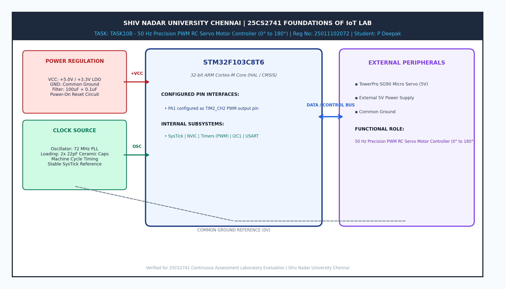

# EXPERIMENT DETAILS

**EXP:** CONTINUOUS ASSESSMENT 10

**DATE:** 21/09/2026

**NAME OF EXP:** Timer Actuation – Servo Motor Angle Positioner

**HARDWARE SETUP / PLATFORM:** STM32F103C8T6 + Keil MDK-ARM (HAL)

---

## TASK10B : 50 Hz Precision PWM RC Servo Motor Controller (0° to 180°)

### 1. Circuit Diagram

Generates a 50 Hz PWM control pulse (20 ms period) to command an SG90 RC servo motor between 0 degrees (1.0 ms pulse), 90 degrees (1.5 ms pulse), and 180 degrees (2.0 ms pulse).

- **Target Microcontroller:** STM32F103C8T6
- **Oscillator / Clock Tree:** 72 MHz PLL
- **Configured Pin Allocations:** PA1 configured as TIM2_CH2 PWM output pin
- **External Hardware Peripherals:** TowerPro SG90 Micro Servo (5V), External 5V Power Supply, Common Ground
- **Power Supply Rails:** +5.0V / +3.3V DC Regulated, Common Ground (GND)



### 2. Core Logic / Pseudocode / Code Base

**Working Principle:**

PSC = 71 (1 MHz counter). Period ARR = 19999 gives period = 20000 us = 20 ms (50 Hz). Pulse widths: 0° -> CCR2 = 1000 (1 ms); 90° -> CCR2 = 1500 (1.5 ms); 180° -> CCR2 = 2000 (2 ms).

**Pseudocode:**

1. Configure TIM2_CH2 for 50 Hz PWM (ARR=19999, PSC=71).
2. Start PWM: HAL_TIM_PWM_Start(&htim2, TIM_CHANNEL_2).
3. In loop:
   a. Set CCR2 = 1000 (0 deg), delay 1000ms.
   b. Set CCR2 = 1500 (90 deg), delay 1000ms.
   c. Set CCR2 = 2000 (180 deg), delay 1000ms.

**Code Structure / Key Registers:**

50 Hz timer timebase, servo pulse mapping, compare register modulation.

#### Embedded C Source Implementation (`main.c`):

```c
#include "main.h"

TIM_HandleTypeDef htim2;

int main(void) {
    HAL_Init();
    SystemClock_Config();
    MX_GPIO_Init();
    MX_TIM2_Init();

    HAL_TIM_PWM_Start(&htim2, TIM_CHANNEL_2);

    while (1) {
        __HAL_TIM_SET_COMPARE(&htim2, TIM_CHANNEL_2, 1000); /* 0 deg */
        HAL_Delay(1000);
        __HAL_TIM_SET_COMPARE(&htim2, TIM_CHANNEL_2, 1500); /* 90 deg */
        HAL_Delay(1000);
        __HAL_TIM_SET_COMPARE(&htim2, TIM_CHANNEL_2, 2000); /* 180 deg */
        HAL_Delay(1000);
    }
}
```

### 3. Inference

Servo arm locked rigidly into calibrated 0°, 90°, and 180° mechanical angles with zero jitter.
