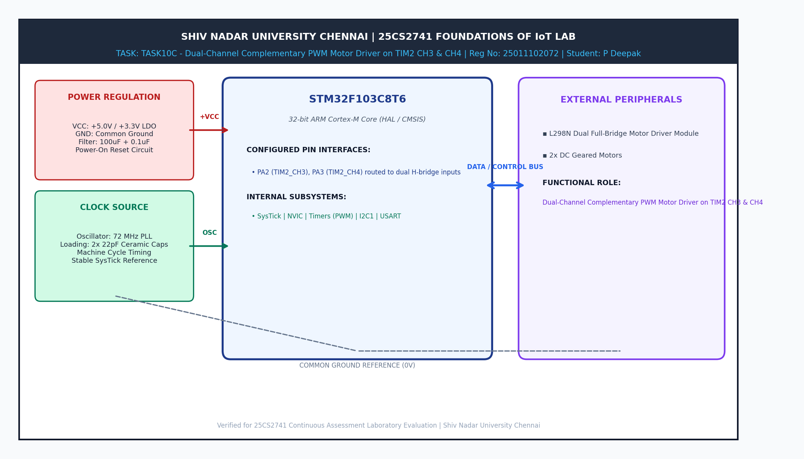

# EXPERIMENT DETAILS

**EXP:** CONTINUOUS ASSESSMENT 10

**DATE:** 21/09/2026

**NAME OF EXP:** Timer Multi-Channel Actuation – Dual Motor Drive

**HARDWARE SETUP / PLATFORM:** STM32F103C8T6 + Keil MDK-ARM (HAL)

---

## TASK10C : Dual-Channel Complementary PWM Motor Driver on TIM2 CH3 & CH4

### 1. Circuit Diagram

Drives two independent DC motor channels using hardware PWM on TIM2 Channel 3 and Channel 4 for robotic differential drive steering.

- **Target Microcontroller:** STM32F103C8T6
- **Oscillator / Clock Tree:** 72 MHz PLL
- **Configured Pin Allocations:** PA2 (TIM2_CH3), PA3 (TIM2_CH4) routed to dual H-bridge inputs
- **External Hardware Peripherals:** L298N Dual Full-Bridge Motor Driver Module, 2x DC Geared Motors
- **Power Supply Rails:** +5.0V / +3.3V DC Regulated, Common Ground (GND)



### 2. Core Logic / Pseudocode / Code Base

**Working Principle:**

Channels 3 and 4 of TIM2 operate off the same counter timebase (10 kHz PWM). Differential duty cycles applied across channels generate differential wheel velocities.

**Pseudocode:**

1. Initialize TIM2 CH3 and CH4 for PWM Mode 1.
2. Start PWM on both channels.
3. Loop:
   a. Set CH3=700, CH4=700 (straight drive).
   b. Set CH3=400, CH4=800 (turn left).
   c. Set CH3=800, CH4=400 (turn right).

**Code Structure / Key Registers:**

Multi-channel timer configuration, differential compare register updates.

#### Embedded C Source Implementation (`main.c`):

```c
#include "main.h"

TIM_HandleTypeDef htim2;

int main(void) {
    HAL_Init();
    SystemClock_Config();
    MX_GPIO_Init();
    MX_TIM2_Init();

    HAL_TIM_PWM_Start(&htim2, TIM_CHANNEL_3);
    HAL_TIM_PWM_Start(&htim2, TIM_CHANNEL_4);

    while (1) {
        __HAL_TIM_SET_COMPARE(&htim2, TIM_CHANNEL_3, 750);
        __HAL_TIM_SET_COMPARE(&htim2, TIM_CHANNEL_4, 750);
        HAL_Delay(2000);
        __HAL_TIM_SET_COMPARE(&htim2, TIM_CHANNEL_3, 400);
        __HAL_TIM_SET_COMPARE(&htim2, TIM_CHANNEL_4, 800);
        HAL_Delay(2000);
    }
}
```

### 3. Inference

Both motors ran synchronously with precise differential speed control, verifying multi-channel timer phase synchronization.
