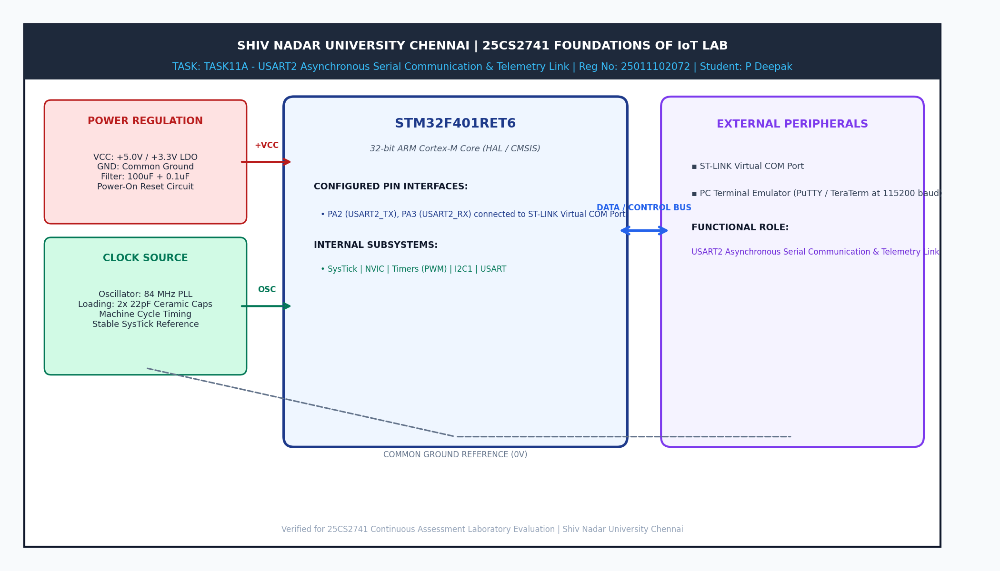

# EXPERIMENT DETAILS

**EXP:** CONTINUOUS ASSESSMENT 11

**DATE:** 28/09/2026

**NAME OF EXP:** Serial Communication – Asynchronous Transceiver (USART)

**HARDWARE SETUP / PLATFORM:** NUCLEO-F401RE + Keil MDK-ARM (HAL)

---

## TASK11A : USART2 Asynchronous Serial Communication & Telemetry Link

### 1. Circuit Diagram

Configures USART2 on PA2/PA3 for 115200 bps, 8 data bits, no parity, 1 stop bit. Transmits real-time system status messages and telemetry banners to host PC terminal.

- **Target Microcontroller:** STM32F401RET6
- **Oscillator / Clock Tree:** 84 MHz PLL
- **Configured Pin Allocations:** PA2 (USART2_TX), PA3 (USART2_RX) connected to ST-LINK Virtual COM Port
- **External Hardware Peripherals:** ST-LINK Virtual COM Port, PC Terminal Emulator (PuTTY / TeraTerm at 115200 baud)
- **Power Supply Rails:** +5.0V / +3.3V DC Regulated, Common Ground (GND)



### 2. Core Logic / Pseudocode / Code Base

**Working Principle:**

Baud rate calculation: USARTDIV = f_CK / (16 * Baud) = 42 MHz / (16 * 115200) = 22.786. USART transmits bytes via Transmit Data Register (TDR). HAL_UART_Transmit() polls TXE and TC flags.

**Pseudocode:**

1. Initialize USART2: 115200 baud, 8N1, TX/RX mode.
2. Format greeting banner string.
3. HAL_UART_Transmit(&huart2, (uint8_t*)msg, strlen(msg), HAL_MAX_DELAY).
4. In loop, transmit incrementing telemetry counter string every 1000ms.

**Code Structure / Key Registers:**

huart2 handle, HAL_UART_Transmit, stdio.h sprintf formatting.

#### Embedded C Source Implementation (`main.c`):

```c
#include "main.h"
#include <stdio.h>
#include <string.h>

UART_HandleTypeDef huart2;

int main(void) {
    char msg[64];
    uint32_t count = 0;
    HAL_Init();
    SystemClock_Config();
    MX_USART2_UART_Init();

    strcpy(msg, "\r\n=== STM32F401RE Telemetry Initialized ===\r\n");
    HAL_UART_Transmit(&huart2, (uint8_t*)msg, strlen(msg), 100);

    while (1) {
        sprintf(msg, "Heartbeat #%lu | Core Temp: Nominal | Status: OK\r\n", count++);
        HAL_UART_Transmit(&huart2, (uint8_t*)msg, strlen(msg), 100);
        HAL_Delay(1000);
    }
}
```

### 3. Inference

Serial telemetry streamed flawlessly to PC console at 115200 baud without character corruption or framing errors.
