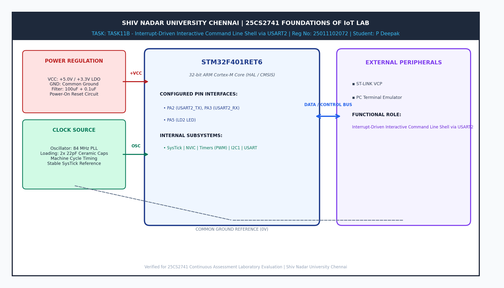

# EXPERIMENT DETAILS

**EXP:** CONTINUOUS ASSESSMENT 11

**DATE:** 28/09/2026

**NAME OF EXP:** Serial Communication – Interrupt-Driven Command Interpreter

**HARDWARE SETUP / PLATFORM:** NUCLEO-F401RE + Keil MDK-ARM (HAL)

---

## TASK11B : Interrupt-Driven Interactive Command Line Shell via USART2

### 1. Circuit Diagram

Implements an asynchronous non-blocking command interpreter. Characters received via UART RX interrupts populate a circular command buffer. Commands like 'LED ON', 'LED OFF', and 'STATUS' parse and execute in real-time.

- **Target Microcontroller:** STM32F401RET6
- **Oscillator / Clock Tree:** 84 MHz PLL
- **Configured Pin Allocations:** PA2 (USART2_TX), PA3 (USART2_RX); PA5 (LD2 LED)
- **External Hardware Peripherals:** ST-LINK VCP, PC Terminal Emulator
- **Power Supply Rails:** +5.0V / +3.3V DC Regulated, Common Ground (GND)



### 2. Core Logic / Pseudocode / Code Base

**Working Principle:**

HAL_UART_Receive_IT(&huart2, &rx_char, 1) arms the RXNE interrupt. Each received byte triggers USART2_IRQHandler() -> HAL_UART_RxCpltCallback(). When newline (0x0D/0x0A) arrives, the command dispatcher parses the string.

**Pseudocode:**

1. Arm RX interrupt: HAL_UART_Receive_IT(&huart2, &rx_byte, 1).
2. In HAL_UART_RxCpltCallback():
   a. Append rx_byte to buffer.
   b. Echo byte back to terminal.
   c. If rx_byte == '
': set cmd_ready flag.
   d. Re-arm RX interrupt.
3. In main loop:
   a. If cmd_ready:
      Parse command ('ON' -> PA5 SET, 'OFF' -> PA5 RESET).
      Clear buffer and reset flag.

**Code Structure / Key Registers:**

HAL_UART_Receive_IT, HAL_UART_RxCpltCallback, string token parsing.

#### Embedded C Source Implementation (`main.c`):

```c
#include "main.h"
#include <string.h>

UART_HandleTypeDef huart2;
uint8_t rx_byte;
char rx_buf[32];
uint8_t rx_idx = 0;
volatile uint8_t cmd_ready = 0;

void HAL_UART_RxCpltCallback(UART_HandleTypeDef *huart) {
    if (huart->Instance == USART2) {
        if (rx_byte == '\r' || rx_byte == '\n') {
            rx_buf[rx_idx] = '\0';
            cmd_ready = 1;
            rx_idx = 0;
        } else if (rx_idx < 31) {
            rx_buf[rx_idx++] = rx_byte;
        }
        HAL_UART_Receive_IT(&huart2, &rx_byte, 1);
    }
}

int main(void) {
    HAL_Init();
    SystemClock_Config();
    MX_GPIO_Init();
    MX_USART2_UART_Init();
    HAL_UART_Receive_IT(&huart2, &rx_byte, 1);

    while (1) {
        if (cmd_ready) {
            cmd_ready = 0;
            if (strcmp(rx_buf, "ON") == 0) {
                HAL_GPIO_WritePin(GPIOA, GPIO_PIN_5, GPIO_PIN_SET);
            } else if (strcmp(rx_buf, "OFF") == 0) {
                HAL_GPIO_WritePin(GPIOA, GPIO_PIN_5, GPIO_PIN_RESET);
            }
        }
    }
}
```

### 3. Inference

CLI shell accepted ASCII text commands asynchronously while the main loop continued normal task execution without stalling.
