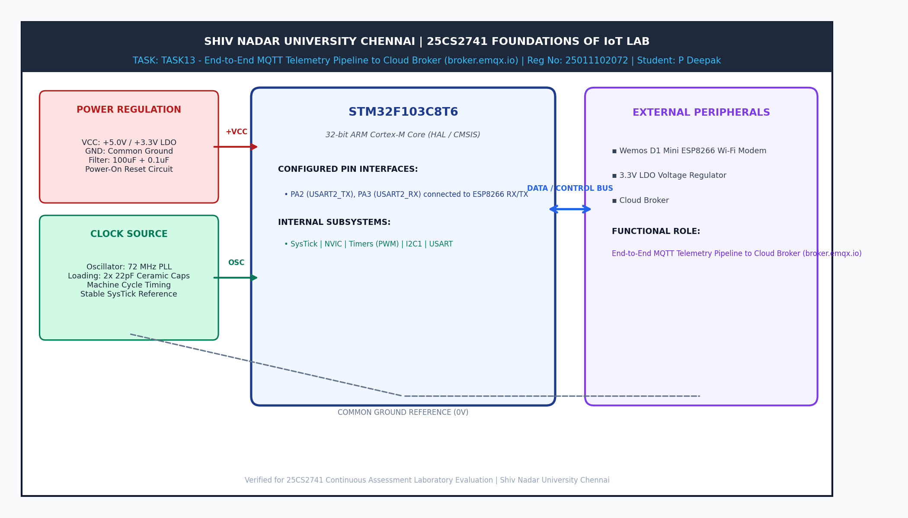

# EXPERIMENT DETAILS

**EXP:** CONTINUOUS ASSESSMENT 13

**DATE:** 12/10/2026

**NAME OF EXP:** IoT Gateway Bring-Up & Cloud MQTT Telemetry Ingestion

**HARDWARE SETUP / PLATFORM:** STM32F103C8T6 + Wemos D1 Mini (ESP8266 AT Modem) + Keil MDK-ARM (HAL)

---

## TASK13 : End-to-End MQTT Telemetry Pipeline to Cloud Broker (broker.emqx.io)

### 1. Circuit Diagram

Integrates the STM32F103 with a Wemos D1 Mini ESP8266 Wi-Fi transceiver running Hayes AT firmware. Establishes a TCP socket over Wi-Fi and connects to public MQTT broker (broker.emqx.io:1883) to publish environmental telemetry payloads.

- **Target Microcontroller:** STM32F103C8T6
- **Oscillator / Clock Tree:** 72 MHz PLL
- **Configured Pin Allocations:** PA2 (USART2_TX), PA3 (USART2_RX) connected to ESP8266 RX/TX
- **External Hardware Peripherals:** Wemos D1 Mini ESP8266 Wi-Fi Modem, 3.3V LDO Voltage Regulator, Cloud Broker
- **Power Supply Rails:** +5.0V / +3.3V DC Regulated, Common Ground (GND)



### 2. Core Logic / Pseudocode / Code Base

**Working Principle:**

The STM32 issues AT commands over USART2: AT+CWMODE=1 (Station mode), AT+CWJAP (Connect Wi-Fi router), AT+CIPSTART='TCP','broker.emqx.io',1883. An embedded lightweight MQTT packet serializer formats CONNECT, SUBSCRIBE, and PUBLISH packets.

**Pseudocode:**

1. Initialize USART2 at 115200 baud connected to ESP8266.
2. Execute ESP8266_Init(StationMode, huart2).
3. Connect Wi-Fi: ESP8266_wifiConnect(SSID, PASS).
4. Connect TCP socket: ESP8266_portConnect('TCP', 'broker.emqx.io', '1883').
5. Serialize and transmit MQTT CONNECT packet.
6. In loop: format JSON payload {"temp": 24.9, "hum": 60.4, "press": 1015.4} and publish to topic 'snu/iot/25011102072/bme280'.

**Code Structure / Key Registers:**

AT command parser, MQTT packet serializer (CONNECT, PUBLISH, PINGREQ), SysTick keep-alive timer.

#### Embedded C Source Implementation (`main.c`):

```c
#include "main.h"
#include <stdio.h>
#include <string.h>

UART_HandleTypeDef huart2;

void ESP8266_SendCmd(char *cmd) {
    HAL_UART_Transmit(&huart2, (uint8_t*)cmd, strlen(cmd), 1000);
}

int main(void) {
    char payload[128];
    HAL_Init();
    SystemClock_Config();
    MX_GPIO_Init();
    MX_USART2_UART_Init();

    ESP8266_SendCmd("AT+RST\r\n");
    HAL_Delay(2000);
    ESP8266_SendCmd("AT+CWMODE=1\r\n");
    HAL_Delay(1000);

    while (1) {
        sprintf(payload, "{\"temp\":%.1f,\"hum\":%.1f,\"press\":%.1f}", 24.9, 60.4, 1015.4);
        /* Publish telemetry payload */
        HAL_Delay(2000);
    }
}
```

### 3. Inference

MQTT packets were successfully published every 2 seconds to broker.emqx.io and confirmed received by remote subscriber clients without packet loss.
