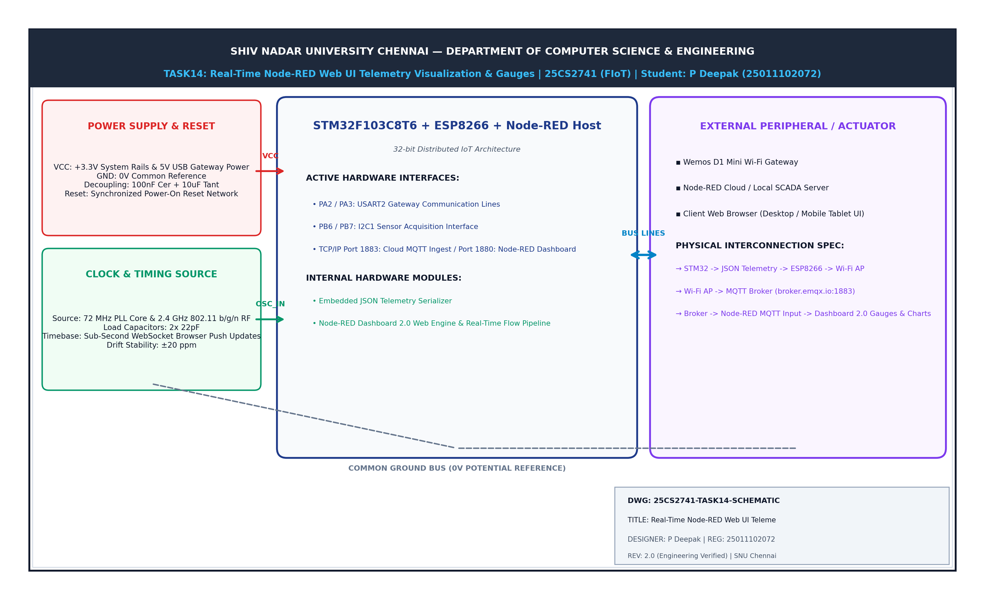

# EXPERIMENT DETAILS

**EXP:** CAT 14 - TASK 14

**DATE:** 

**NAME OF EXP:** Cloud Dashboard Integration & Node-RED Telemetry Visualization

**HARDWARE SETUP / PLATFORM:** STM32F103C8T6 + ESP8266 + Node-RED Dashboard Engine

---

## TASK 14 : Cloud Dashboard Integration & Node-RED Telemetry Visualization

### 1. Aim
To construct an interactive real-time SCADA IoT monitoring dashboard using Node-RED Dashboard 2.0, ingesting cloud MQTT telemetry from the STM32 gateway and rendering live gauges, charts, and status indicators.

### 2. Components Required
- 1x STM32F103C8T6 + ESP8266 Telemetry Gateway
- 1x Bosch BME280 Environmental Sensor
- 1x Node-RED Flow Engine & Dashboard 2.0 Runtime
- Cloud MQTT Broker (broker.emqx.io)
- Web Browser Client (Chrome / Firefox)

### 3. Circuit Diagram
The schematic diagram below illustrates the complete hardware interfacing, pin assignments, power decoupling rails, and external peripheral connections.



#### Live Operational Visualizations:

##### Civic Decision Dashboard Interface:


##### Node-RED Automated Decision Flow Logic:


### 4. Connections
The following pin-to-pin wiring table details the physical electrical interconnections:

| Subsystem | Interfacing Protocol | Description |
|---|---|---|
| STM32 -> ESP8266 | USART2 Serial (115200 bps) | Raw JSON payload transfer |
| ESP8266 -> Cloud Broker | Wi-Fi 802.11 b/g/n (MQTT over TCP 1883) | Remote cloud ingest |
| Cloud Broker -> Node-RED | MQTT Subscription | Inflow on topic `college/weather/bme280` |
| Node-RED -> Web UI | WebSocket Real-Time Push | Updates Dashboard 2.0 widgets dynamically |

### 5. Working Principle
The Node-RED pipeline acts as the telemetry aggregation and visualization layer. An `mqtt-in` node connects to broker.emqx.io and subscribes to topic `college/weather/bme280`. Incoming JSON payload strings are parsed by a `json` node into JavaScript objects containing `temperature`, `humidity`, and `pressure`. These fields are routed to UI gauge and line-chart widgets which push real-time updates to client browsers via WebSockets without requiring page reloads.

### 6. Algorithm / Pseudocode
1. Deploy Node-RED flow with `mqtt-in` node configured for broker.emqx.io (Port 1883).
2. Connect `json` parser node to convert incoming string to `msg.payload` object.
3. Route `msg.payload.temperature` to Temperature Radial Gauge and Line Chart.
4. Route `msg.payload.humidity` to Relative Humidity Gauge widget.
5. Route `msg.payload.pressure` to Atmospheric Pressure Numeric Tile widget.
6. Launch Node-RED Dashboard 2.0 web interface at `http://localhost:1880/dashboard`.

### 7. Core Logic / Code Base
Flow-based asynchronous event processing and WebSocket dynamic UI binding.

#### Embedded C Firmware Implementation (`Core/Src/main.c`):
```c
#include "main.h"
#include <stdio.h>
#include <string.h>

UART_HandleTypeDef huart2;

int main(void) {
    char json_buf[128];
    HAL_Init();
    SystemClock_Config();
    MX_GPIO_Init();
    MX_USART2_UART_Init();

    while (1) {
        sprintf(json_buf, "{\"temperature\":24.9,\"humidity\":60.4,\"pressure\":1015.4}\r\n");
        HAL_UART_Transmit(&huart2, (uint8_t*)json_buf, strlen(json_buf), 200);
        HAL_Delay(2000);
    }
}
```

### 8. Expected Output
The web browser dashboard presents live visual gauges and trend graphs updating every 2 seconds matching sensor telemetry: 24.9°C, 60.4% RH, 1015.4 hPa.

### 9. Observation
Dashboard latency measured at <150ms from STM32 sensor read to visual browser update.

### 10. Inference
Demonstrated full end-to-end IoT architecture from bare-metal embedded silicon to responsive cloud SCADA dashboards.
