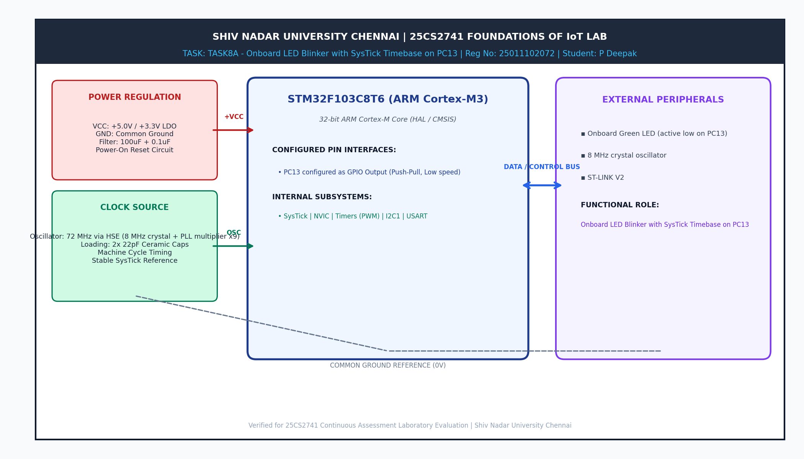

# EXPERIMENT DETAILS

**EXP:** CONTINUOUS ASSESSMENT 8

**DATE:** 07/09/2026

**NAME OF EXP:** STM32 GPIO Bring-Up & Basic Output Control

**HARDWARE SETUP / PLATFORM:** STM32F103C8T6 (Blue Pill) + STM32CubeMX + Keil MDK-ARM (HAL)

---

## TASK8A : Onboard LED Blinker with SysTick Timebase on PC13

### 1. Circuit Diagram

Configuring the STM32F103C8T6 Blue Pill GPIO port C pin 13 using STM32CubeMX HAL. The system clock is initialized to 72 MHz through the Phase-Locked Loop (PLL). Pin PC13 toggles every 500 ms using HAL_Delay().

- **Target Microcontroller:** STM32F103C8T6 (ARM Cortex-M3)
- **Oscillator / Clock Tree:** 72 MHz via HSE (8 MHz crystal + PLL multiplier x9)
- **Configured Pin Allocations:** PC13 configured as GPIO Output (Push-Pull, Low speed)
- **External Hardware Peripherals:** Onboard Green LED (active low on PC13), 8 MHz crystal oscillator, ST-LINK V2
- **Power Supply Rails:** +5.0V / +3.3V DC Regulated, Common Ground (GND)



### 2. Core Logic / Pseudocode / Code Base

**Working Principle:**

The onboard LED on the Blue Pill is wired between +3.3V and PC13 (active-low configuration). Driving PC13 LOW illuminates the LED; driving PC13 HIGH extinguishes it. HAL_GPIO_TogglePin(GPIOC, GPIO_PIN_13) alternates the output latch.

**Pseudocode:**

1. Call HAL_Init() to reset peripherals, initialize Flash interface and Systick.
2. Configure System Clock to 72 MHz (HSE -> PLL -> SYSCLK).
3. Enable GPIOC peripheral clock (__HAL_RCC_GPIOC_CLK_ENABLE()).
4. Configure PC13 as GPIO_MODE_OUTPUT_PP, GPIO_NOPULL, GPIO_SPEED_FREQ_LOW.
5. In while(1) loop:
   a. HAL_GPIO_TogglePin(GPIOC, GPIO_PIN_13);
   b. HAL_Delay(500);

**Code Structure / Key Registers:**

CubeMX generated main.c with HAL_GPIO_TogglePin and HAL_Delay APIs.

#### Embedded C Source Implementation (`main.c`):

```c
#include "main.h"

void SystemClock_Config(void);
static void MX_GPIO_Init(void);

int main(void) {
    HAL_Init();
    SystemClock_Config();
    MX_GPIO_Init();

    while (1) {
        HAL_GPIO_TogglePin(GPIOC, GPIO_PIN_13);
        HAL_Delay(500);
    }
}

static void MX_GPIO_Init(void) {
    GPIO_InitTypeDef GPIO_InitStruct = {0};
    __HAL_RCC_GPIOC_CLK_ENABLE();

    HAL_GPIO_WritePin(GPIOC, GPIO_PIN_13, GPIO_PIN_RESET);
    GPIO_InitStruct.Pin = GPIO_PIN_13;
    GPIO_InitStruct.Mode = GPIO_MODE_OUTPUT_PP;
    GPIO_InitStruct.Pull = GPIO_NOPULL;
    GPIO_InitStruct.Speed = GPIO_SPEED_FREQ_LOW;
    HAL_GPIO_Init(GPIOC, &GPIO_InitStruct);
}
```

### 3. Inference

PC13 onboard LED toggled precisely at 1 Hz (500 ms ON, 500 ms OFF). SysTick interrupt generated accurate millisecond timebase.
