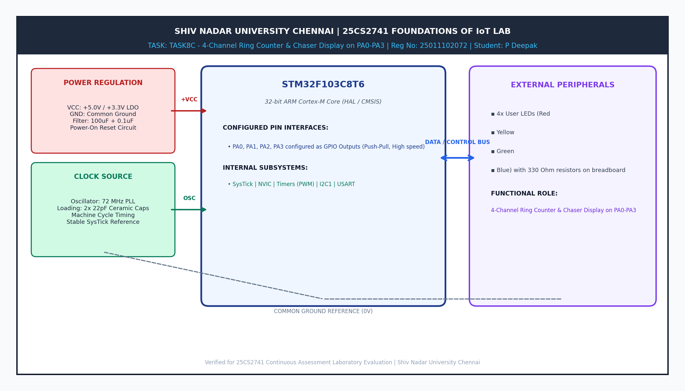

# EXPERIMENT DETAILS

**EXP:** CONTINUOUS ASSESSMENT 8

**DATE:** 07/09/2026

**NAME OF EXP:** STM32 Multi-LED Sequence & Pattern Generator

**HARDWARE SETUP / PLATFORM:** STM32F103C8T6 (Blue Pill) + Keil MDK-ARM (HAL)

---

## TASK8C : 4-Channel Ring Counter & Chaser Display on PA0-PA3

### 1. Circuit Diagram

Four external LEDs connected to Port A lower nibble (PA0-PA3) execute a cyclic chasing light pattern with forward and reverse directional shifts.

- **Target Microcontroller:** STM32F103C8T6
- **Oscillator / Clock Tree:** 72 MHz PLL
- **Configured Pin Allocations:** PA0, PA1, PA2, PA3 configured as GPIO Outputs (Push-Pull, High speed)
- **External Hardware Peripherals:** 4x User LEDs (Red, Yellow, Green, Blue) with 330 Ohm resistors on breadboard
- **Power Supply Rails:** +5.0V / +3.3V DC Regulated, Common Ground (GND)



### 2. Core Logic / Pseudocode / Code Base

**Working Principle:**

Bitmask manipulation over GPIO port pin constants. HAL_GPIO_WritePin sets individual pins HIGH sequentially with 150 ms delays to create continuous scanning visual motion.

**Pseudocode:**

1. Configure PA0 - PA3 as GPIO_MODE_OUTPUT_PP.
2. Store pins in array: uint16_t leds[4] = {GPIO_PIN_0, GPIO_PIN_1, GPIO_PIN_2, GPIO_PIN_3};
3. Loop through 0 to 3, turn pin ON, HAL_Delay(150), turn OFF.
4. Loop through 2 down to 1 for reverse ping-pong bounce effect.

**Code Structure / Key Registers:**

Array-driven pin sequencing using HAL_GPIO_WritePin.

#### Embedded C Source Implementation (`main.c`):

```c
#include "main.h"

void SystemClock_Config(void);
static void MX_GPIO_Init(void);

int main(void) {
    uint16_t leds[4] = {GPIO_PIN_0, GPIO_PIN_1, GPIO_PIN_2, GPIO_PIN_3};
    int i;
    HAL_Init();
    SystemClock_Config();
    MX_GPIO_Init();

    while (1) {
        for (i = 0; i < 4; i++) {
            HAL_GPIO_WritePin(GPIOA, leds[i], GPIO_PIN_SET);
            HAL_Delay(150);
            HAL_GPIO_WritePin(GPIOA, leds[i], GPIO_PIN_RESET);
        }
        for (i = 2; i > 0; i--) {
            HAL_GPIO_WritePin(GPIOA, leds[i], GPIO_PIN_SET);
            HAL_Delay(150);
            HAL_GPIO_WritePin(GPIOA, leds[i], GPIO_PIN_RESET);
        }
    }
}
```

### 3. Inference

All 4 LEDs chased smoothly in ping-pong succession without cross-channel flicker.
