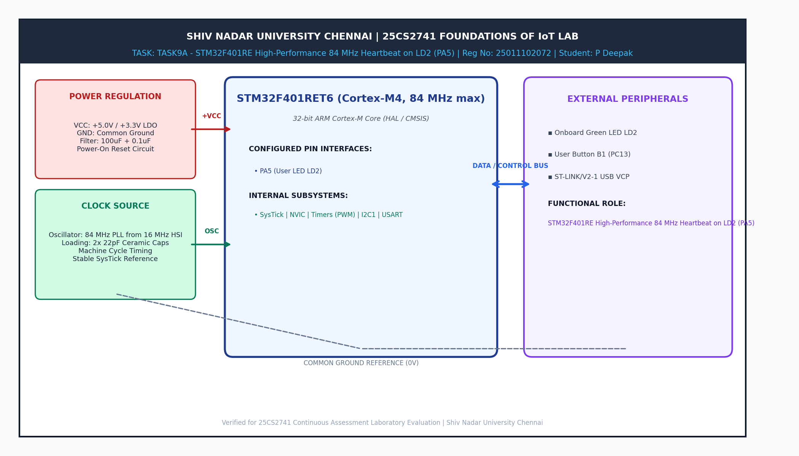

# EXPERIMENT DETAILS

**EXP:** CONTINUOUS ASSESSMENT 9

**DATE:** 14/09/2026

**NAME OF EXP:** STM32F401 Hardware Bring-Up & Multi-Clock Setup

**HARDWARE SETUP / PLATFORM:** NUCLEO-F401RE (STM32F401RET6 ARM Cortex-M4 with FPU) + Keil MDK-ARM

---

## TASK9A : STM32F401RE High-Performance 84 MHz Heartbeat on LD2 (PA5)

### 1. Circuit Diagram

Brings up the ARM Cortex-M4 NUCLEO-F401RE development platform. System clock is configured to 84 MHz maximum operational frequency using internal High-Speed Internal (HSI) RC oscillator routed through PLL.

- **Target Microcontroller:** STM32F401RET6 (Cortex-M4, 84 MHz max)
- **Oscillator / Clock Tree:** 84 MHz PLL from 16 MHz HSI
- **Configured Pin Allocations:** PA5 (User LED LD2)
- **External Hardware Peripherals:** Onboard Green LED LD2, User Button B1 (PC13), ST-LINK/V2-1 USB VCP
- **Power Supply Rails:** +5.0V / +3.3V DC Regulated, Common Ground (GND)



### 2. Core Logic / Pseudocode / Code Base

**Working Principle:**

Cortex-M4 features Harvard architecture, 3-stage pipeline, branch speculation, and hardware Floating Point Unit (FPU). Pin PA5 directly drives the green user LED LD2. The clock tree uses PLL_M=16, PLL_N=336, PLL_P=4 to generate 84 MHz SYSCLK.

**Pseudocode:**

1. Initialize HAL and configure SystemClock to 84 MHz.
2. Configure PA5 as GPIO_MODE_OUTPUT_PP.
3. In while(1):
   a. HAL_GPIO_TogglePin(GPIOA, GPIO_PIN_5);
   b. HAL_Delay(250);

**Code Structure / Key Registers:**

STM32F4xx HAL configuration, clock tree configuration struct, GPIO initialization.

#### Embedded C Source Implementation (`main.c`):

```c
#include "main.h"

void SystemClock_Config(void);
static void MX_GPIO_Init(void);

int main(void) {
    HAL_Init();
    SystemClock_Config();
    MX_GPIO_Init();

    while (1) {
        HAL_GPIO_TogglePin(GPIOA, GPIO_PIN_5);
        HAL_Delay(250);
    }
}
```

### 3. Inference

The Cortex-M4 core operated stably at full 84 MHz speed. LD2 blinked at crisp 2 Hz heartbeat.
