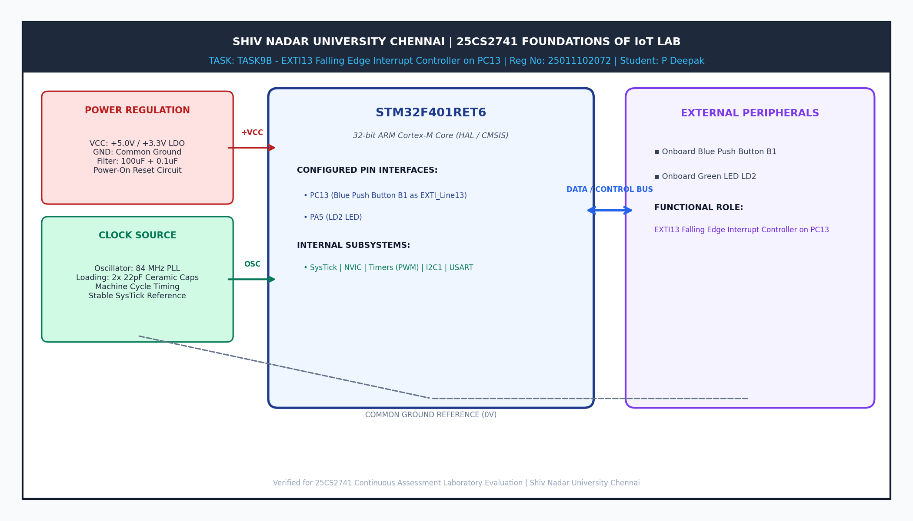

# EXPERIMENT DETAILS

**EXP:** CONTINUOUS ASSESSMENT 9

**DATE:** 14/09/2026

**NAME OF EXP:** STM32F4 User Button & Asynchronous External Interrupts (EXTI)

**HARDWARE SETUP / PLATFORM:** NUCLEO-F401RE + Keil MDK-ARM

---

## TASK9B : EXTI13 Falling Edge Interrupt Controller on PC13

### 1. Circuit Diagram

Configures EXTI Line 13 on pin PC13 to service asynchronous user button clicks via nested vector interrupt controller (NVIC). The interrupt service routine toggles LD2.

- **Target Microcontroller:** STM32F401RET6
- **Oscillator / Clock Tree:** 84 MHz PLL
- **Configured Pin Allocations:** PC13 (Blue Push Button B1 as EXTI_Line13); PA5 (LD2 LED)
- **External Hardware Peripherals:** Onboard Blue Push Button B1, Onboard Green LED LD2
- **Power Supply Rails:** +5.0V / +3.3V DC Regulated, Common Ground (GND)



### 2. Core Logic / Pseudocode / Code Base

**Working Principle:**

EXTI15_10_IRQn handles interrupt lines 10 to 15. The SYSCFG peripheral maps port C pin 13 to EXTI line 13. When pressed, the falling edge invokes EXTI15_10_IRQHandler(), which calls HAL_GPIO_EXTI_Callback(uint16_t GPIO_Pin).

**Pseudocode:**

1. Configure PC13 as GPIO_MODE_IT_FALLING with GPIO_NOPULL.
2. Set NVIC priority for EXTI15_10_IRQn (Priority 2, SubPriority 0) and enable IRQ.
3. Implement HAL_GPIO_EXTI_Callback(GPIO_Pin):
   If GPIO_Pin == GPIO_PIN_13, toggle PA5.
4. Main loop sleeps with __WFI() (Wait For Interrupt) to save power.

**Code Structure / Key Registers:**

NVIC interrupt enabling, EXTI line routing, HAL_GPIO_EXTI_Callback hook.

#### Embedded C Source Implementation (`main.c`):

```c
#include "main.h"

void SystemClock_Config(void);
static void MX_GPIO_Init(void);

void HAL_GPIO_EXTI_Callback(uint16_t GPIO_Pin) {
    if (GPIO_Pin == GPIO_PIN_13) {
        HAL_GPIO_TogglePin(GPIOA, GPIO_PIN_5);
    }
}

int main(void) {
    HAL_Init();
    SystemClock_Config();
    MX_GPIO_Init();

    while (1) {
        __WFI(); /* Sleep and wait for interrupt */
    }
}
```

### 3. Inference

Button presses immediately triggered LED toggle via interrupt vector with zero latency and ultra-low CPU load.
